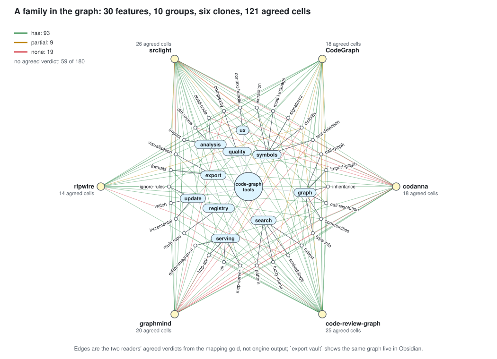
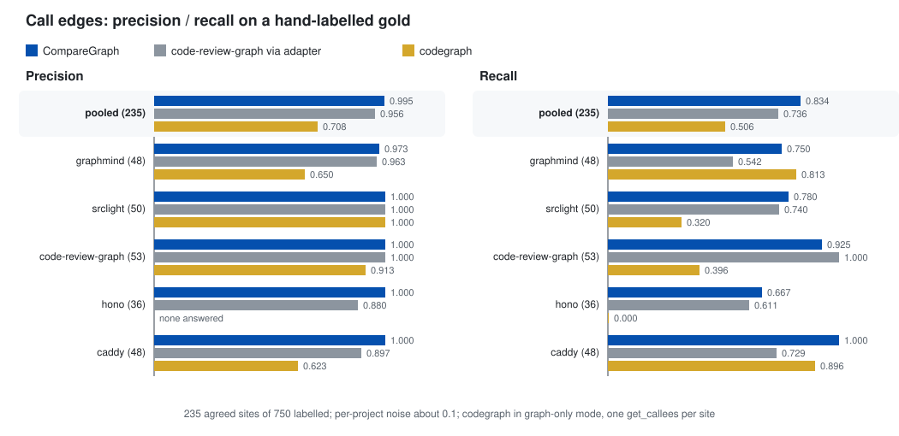
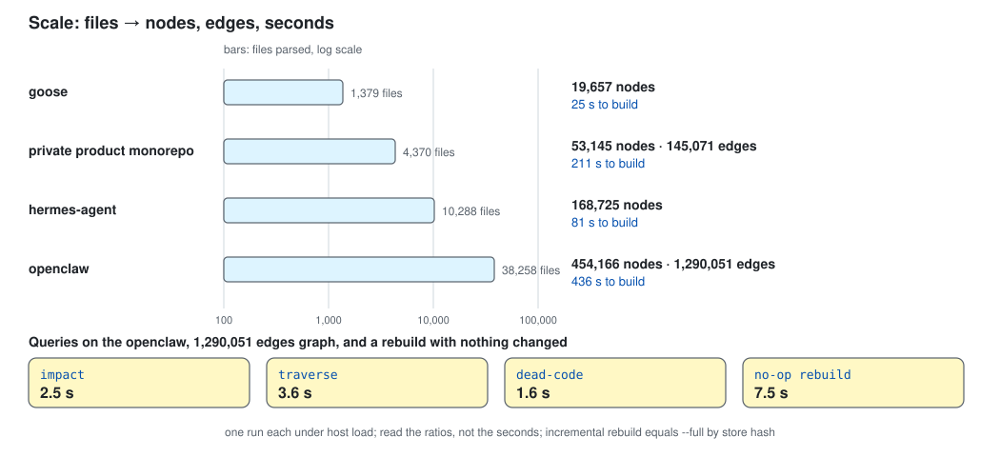

<h1 align="center">CompareGraph</h1>

<p align="center"><b>Already installed?</b> Run <code>comparegraph doctor</code>.</p>

<p align="center">
  <b>Compare many repositories with Claude Code, Codex, Cursor, Gemini CLI, Windsurf, OpenCode and six more agents</b>
</p>

<p align="center">
  <b>One graph over many clones · a verdict with a citation on every cell · 29 languages · 100% local, no model calls</b><br>
  <b>One Rust binary</b>
</p>

<p align="center">
  <a href="https://github.com/massrelay-ai/comparegraph/actions/workflows/ci.yml"></a> <a href="https://github.com/massrelay-ai/comparegraph/releases/latest"></a> <a href="https://www.npmjs.com/package/@massrelay-ai/comparegraph"></a> <a href="LICENSE"></a>
  <a href="#get-started"></a>  
    
</p>

<p align="center">
  <a href="#get-started"></a> <a href="#get-started"></a> <a href="#get-started"></a>
  <a href="#get-started"></a> <a href="#get-started"></a>
</p>

<p align="center">
  <a href="#agents-platforms-uninstall"></a> <a href="#agents-platforms-uninstall"></a> <a href="#agents-platforms-uninstall"></a>
  <a href="#agents-platforms-uninstall"></a> <a href="#agents-platforms-uninstall"></a> <a href="#agents-platforms-uninstall"></a>
  <a href="#agents-platforms-uninstall"></a> <a href="#agents-platforms-uninstall"></a> <a href="#agents-platforms-uninstall"></a>
  <a href="#agents-platforms-uninstall"></a> <a href="#agents-platforms-uninstall"></a> <a href="#agents-platforms-uninstall"></a>
</p>

<p align="center">
  <a href="docs/usage.md">Usage</a> ·
  <a href="docs/commands.md">Commands</a> ·
  <a href="docs/mcp-tools.md">MCP tools</a> ·
  <a href="docs/faq.md">FAQ</a> ·
  <a href="docs/troubleshooting.md">Troubleshooting</a> ·
  <a href="docs/roadmap.md">Roadmap</a> ·
  <a href="docs/reports/README.md">Reports</a>
</p>

<!-- sources: Cargo.toml (licence, rust-version); docs/catalog.json (18 tools); walker.rs language_for (29 languages); application/setup.rs (12 clients, the Agents table order); .github/workflows/ci.yml; release.yml (five platform builds, SHA256SUMS) -->

<br>

CompareGraph parses many cloned repositories into one SQLite graph. It scores each clone against a taxonomy (a "family"
of features) and records, per clone and feature, a verdict with a citation to a file and line range. It is one Rust
binary with a CLI and an MCP server. It reads clones and never runs them. It never calls a model.


---

## Get started

No runtime to install: one binary. Node users can run the same binary through `npx -y @massrelay-ai/comparegraph`.

### 1. Install the binary

```bash
# macOS / Linux
curl -fsSL https://raw.githubusercontent.com/massrelay-ai/comparegraph/main/scripts/install.sh | sh

# Windows x64 (PowerShell)
irm https://raw.githubusercontent.com/massrelay-ai/comparegraph/main/scripts/install.ps1 | iex
```

<sub>Checked against the release's `SHA256SUMS` (linux-x64, linux-arm64, darwin-arm64, darwin-x64, win32-x64; from v0.1.2 also attested: `gh attestation verify <asset> -R massrelay-ai/comparegraph`), then written to `~/.local/bin` (Windows: `%LOCALAPPDATA%\Programs\comparegraph`, added to your user `PATH`; open a new terminal there). `COMPAREGRAPH_VERSION=v0.1.1` pins a release; `COMPAREGRAPH_INSTALL_DIR` moves the binary.</sub>

<details>
<summary><b>Other routes: npm, Homebrew, by hand, from source</b></summary>

**npm**, any of the five platforms with Node 18 or newer (the package wraps the same release binaries): `npx -y @massrelay-ai/comparegraph --version`, or `npm i -g @massrelay-ai/comparegraph`.

**Homebrew**, macOS and Linux: `brew install massrelay-ai/comparegraph/comparegraph`.

**By hand:** `comparegraph-<platform>` and `SHA256SUMS` from the
[latest release](https://github.com/massrelay-ai/comparegraph/releases/latest). From source, anywhere Rust 1.85 or newer
runs: `cargo install --locked --git https://github.com/massrelay-ai/comparegraph comparegraph` (`--locked` matters: the
Perl grammar's newest release on crates.io is yanked, and only `Cargo.lock` resolves).

</details>

### 2. Wire up your agents

```bash
comparegraph setup --apply      # omit --apply for the plan; --scope project for an entry you commit
comparegraph doctor             # each client's state: aligned, stale, conflict, missing, plugin
```

<sub>Registers the MCP server with every agent it finds on the machine (twelve: Claude Code, Codex, Cursor, Gemini CLI, OpenCode, Hermes, Windsurf, Antigravity, Kiro, Copilot, Copilot CLI, Qwen Code), writes a short rules block into the workspace's instruction file, and for Claude Code a session-start hook. It only wires agents; it indexes nothing.</sub>

<details>
<summary><b>Claude Code as a plugin, or your agent's own command</b></summary>

**Claude Code as a plugin:** the seven skills, the server and the hook in one install (Claude Code 2.1.275 or newer;
`claude plugin install …` does the same from a shell):

```text
/plugin install comparegraph --marketplace massrelay-ai/comparegraph
```

With the plugin enabled, `setup --apply` leaves Claude Code's server and hook to the plugin (their rows read `plugin`)
and still writes the rules block.

**Your agent's own command**, run in the workspace; each writes the user-scope entry `setup` would (Claude Code's
default scope, `local`, is one `doctor` does not read), so `doctor` reads it as aligned:

| Agent | Command |
|---|---|
| Claude Code | `claude mcp add --scope user comparegraph -- comparegraph --root "$PWD" mcp` |
| Codex | `codex mcp add comparegraph -- comparegraph --root "$PWD" mcp` |
| Gemini CLI | `gemini mcp add -s user comparegraph comparegraph -- --root "$PWD" mcp` |

The server is listed in the [MCP Registry](https://registry.modelcontextprotocol.io) as `io.github.massrelay-ai/comparegraph`;
the [table](#agents-platforms-uninstall) has every client's file.

</details>

### 3. Add and build clones

```bash
comparegraph add ../some-clone --name some
comparegraph build some
```

<sub>A clone is read, never run. One store per workspace, under `.comparegraph/`. Rebuilds are incremental and hash-equal to `build --full`.</sub>

### 4. Compare

```bash
comparegraph family add families/example-code-graph-tools   # the taxonomy
comparegraph map some example-code-graph-tools              # ranked candidates per feature, writes nothing
comparegraph claim some symbols.extraction has --author me --at <path>:<start>-<end>
comparegraph matrix example-code-graph-tools                # features x clones, prevalence, gaps
```

<sub>The family pack ships in this repository, not in the binary, so run these inside a clone of it. The [sample below](docs/usage.md#quick-start-on-the-shipped-sample) walks the shipped sample through all of these with real output.</sub>

### Quick start on the shipped sample

The example pack and sample repositories ship in the repository, not in the binary. [Usage](docs/usage.md#quick-start-on-the-shipped-sample) walks `fixtures/typescript` against the ten-feature example pack, from `add` to `export vault`, with the real output of every step.

To uninstall, see [Agents, platforms, uninstall](#agents-platforms-uninstall).

---

## Why CompareGraph

<p align="center"></p>

Measured on six study copies and 30 features, binary 0.1.1: numbers in [`docs/assets/cost.json`](docs/assets/cost.json), method and caveats in the [answer-size report](docs/reports/2026-10-14-answer-size.md).

You have many repositories and one question: who has what? Reading each by hand does not scale, a summary without a line
number cannot be checked, and notes go stale when the code moves. Five properties, each one you can test:

1. **Deterministic.** The same clone and version give the same `store_hash`. `comparegraph check` rebuilds and compares, and
   an incremental build must equal `build --full` (equal on both large trees in the
   [Plan 6 report](docs/reports/2026-10-13-plan-6-recall-and-scale.md)).
2. **An evidence class on every answer.** Each envelope says `observed`, `derived`, `inferred` or `unknown`, plus a
   `limitations[]` list of what the engine cannot see.
3. **A claim needs a citation that resolves now.** `has` and `partial` need `--at path:start-end` matching a stored node;
   otherwise the engine refuses. A moved citation shows as `unknown*` after `check`.
4. **`none` needs proof of absence.** Either `--searched` terms that find nothing, or the graph check: four channels
   (symbols, paths, community terms, node kinds) all empty. Any hit refuses the claim and lists the candidates.
5. **No model in the engine.** Scores, bands, descriptions and candidates are computed from stored facts. An agent may do
   the reading; the engine only stores, checks and refuses.

<details>
<summary><b>Against a single-repo code graph</b></summary>

| Need | Single-repo code graph | CompareGraph |
|---|---|---|
| Compare several repos on one feature list | no, one repo per index | `family`, `relate`, `matrix` |
| Keep the evidence beside the verdict | no | a claim stores `path:start-end` and a content hash |
| Refuse a claim it cannot support | no | `has` and `partial` need a live citation; `none` needs a search the engine ran |
| Show what changed after the code moved | no | `check` marks a moved citation stale; the matrix shows `unknown*` |
| Keep a trail of who said what | no | claims and decisions are append-only |

</details>

For: teams comparing their product with the field, due diligence on a set of projects, a newcomer mapping a field
(`family propose` drafts the taxonomy), and coding agents that need compact facts over MCP.

---

## How it works

<p align="center"></p>

### The three rules

1. **The engine never calls a model.** Every score, band, description and candidate is computed from stored facts.
2. **A claim needs a citation that resolves now.** `has` and `partial` need `--at path:start-end` matching a stored node.
   `none` needs `--searched` terms that find nothing, or the graph check. Otherwise the engine refuses or writes `unknown`.
3. **Claims and decisions are append-only, enforced by the database.** A change is a new row naming the one it supersedes.
   The latest wins, and the trail stays.

A candidate from `search` or `map` is labelled `candidate`, never `has`. Design:
[`docs/design.md`](docs/design.md).

The flow and the code rings as diagrams: [`docs/design.md`](docs/design.md#16-diagrams).

### A family in the graph

<p align="center"></p>

A family is a taxonomy: groups of features, each with a definition and a test for what counts as having it. A cell is one clone against one feature, holding a verdict (`has`, `partial`, `none`) and, for `has` and `partial`, a citation. The picture draws the family `code-graph-tools` with the agreed cells of the mapping gold; `comparegraph export vault` shows the same graph live in Obsidian.

### Plugins and the second engine

An external provider is any executable that speaks JSON lines on stdin and stdout: the host writes one request line, closes
stdin, and reads answer lines until the first `ok` answer. Everything it prints is data, parsed into our own types. Register
one in `comparegraph.toml` (`[providers.mine] command = "tools/my-provider"`) or as `comparegraph-provider-<name>` on `PATH`,
with a `comparegraph-plugin.toml` manifest beside it (`kind`, `name`, `protocol = "1"`, `languages`, `network`). Without a
manifest it runs only with `--allow-unverified`.

Full protocol, guards, a 25-line Python provider and the code-review-graph adapter (a second engine behind `build --providers reference,crg`): [`docs/dev/plugin-protocol.md`](docs/dev/plugin-protocol.md).

### Families and the seven skills

A family is a directory with a `rows.md`; two packs ship, [`families/example-code-graph-tools`](families/example-code-graph-tools/rows.md) (10 features, the quick start) and [`families/code-graph-tools`](families/code-graph-tools/rows.md) (30 features, the mapping gold). The column rules, synonyms and `family propose` are in [Usage](docs/usage.md#family-packs).

The method is seven plain-markdown skills in [`skills/`](skills) that any agent can read. Each gives when to use the verb, the
exact commands, what the engine refuses, and how to check. In Claude Code the skills and the MCP server arrive together as
one plugin ([Get started](#get-started)); other agents read the `skills/` directory from the clone.

| Skill | One line |
|---|---|
| [`using-comparegraph`](skills/using-comparegraph/SKILL.md) | Entry point: which skill applies, the order of the workflow, the habits that keep verdicts honest. |
| [`adding-a-clone`](skills/adding-a-clone/SKILL.md) | Register a clone as a comparator or the root, parse it, verify the build. |
| [`defining-a-family`](skills/defining-a-family/SKILL.md) | Write a pack, seed one with `family propose`, reload it safely. |
| [`mapping-features`](skills/mapping-features/SKILL.md) | Find candidate evidence and score relatedness. Candidates are leads, never verdicts. |
| [`writing-a-claim`](skills/writing-a-claim/SKILL.md) | Record has, partial, none or unknown with citations that resolve now. |
| [`recording-a-decision`](skills/recording-a-decision/SKILL.md) | Record a person's adopt, reject or park with their name and reason. |
| [`reading-the-vault`](skills/reading-the-vault/SKILL.md) | Read the matrix, the vault and the JSON export, and read gaps correctly. |

---

## Using it

Four pages under `docs/` hold the reference; each is a few clicks from here.

### What you get

Four levels, each answering how it knows: the repo surface, module communities, symbols (callers, callees, blast radius, tests, entry points, dead-code candidates) and claims (verdict, citation, author, trail). Every answer is one JSON envelope with an evidence class. [Usage](docs/usage.md#what-you-get) has the table and a real `show` answer.

### CLI reference

Global options `--root` and `--pretty`, then verbs in four groups: build and inspect, graph queries, families and claims, exports and agents. [Commands](docs/commands.md) lists every verb with the flags that matter.

### MCP tools

`comparegraph mcp` serves eighteen tools over stdio (seventeen read-only, one write: `comparegraph_claim`); there is deliberately no `decide` tool. [MCP tools](docs/mcp-tools.md) has the table; `docs/catalog.json` is the machine-readable source and `catalog --check` guards it in CI.

### The vault, configuration, library

`comparegraph export vault --out ./vault` writes an Obsidian-style markdown vault of notes with generated descriptions. Settings are `--root` and `COMPAREGRAPH_*` environment variables, and the crate exposes each verb as a function. All three are in [Usage](docs/usage.md#the-vault).

---

## How good is it

Every number below is copied from a report in this repository; read its caveats before quoting one. All were measured on
2026-10-13 on one shared host.

<p align="center"></p>

<p align="center"></p>

On the hand-labelled gold of call sites, CompareGraph reaches precision 0.995 and recall 0.834 pooled, against 0.956 / 0.736 for code-review-graph through its adapter and 0.708 / 0.506 for codegraph. It builds a 38,258-file repository in 499.6 s, and `impact` on a 1.29M-edge graph answers in 2.5 s; the tables below carry the caveats. Data: [`accuracy.json`](docs/assets/accuracy.json), [`scale.json`](docs/assets/scale.json); parity report: [engine parity](docs/reports/2026-10-12-engine-parity.md).

<details>
<summary><b>Call edges against a hand-labelled gold standard</b></summary>

The gold: 150 call sites per project (750 in all) drawn at random from each project's own source, labelled by two readers
who worked independently under one rubric (both are language-model agents; none was run blind to the engines). `final` keeps
only the rows both agree on. How the gold is made: [`fixtures/gold/README.md`](fixtures/gold/README.md). Precision is over
answered sites, recall over repo-target sites (shown in brackets). Kappa is Cohen's kappa on the call target between the two
readers.

| Project (sites) | Reader kappa | CompareGraph P / R | code-review-graph via adapter P / R | codegraph P / R |
|---|---|---|---|---|
| graphmind (48) | 0.98 | 0.973 / 0.750 | 0.963 / 0.542 | 0.650 / 0.813 |
| srclight (50) | 0.96 | 1.000 / 0.780 | 1.000 / 0.740 | 1.000 / 0.320 |
| code-review-graph (53) | 1.00 | 1.000 / 0.925 | 1.000 / 1.000 | 0.913 / 0.396 |
| hono (36) | 0.89 | 1.000 / 0.667 | 0.880 / 0.611 | none answered / 0.000 |
| caddy (48) | 0.92 | 1.000 / 1.000 | 0.897 / 0.729 | 0.623 / 0.896 |
| **pooled (235)** | **0.95** | **0.995 / 0.834** | 0.956 / 0.736 | 0.708 / 0.506 |

Pooled counts: CompareGraph 196 correct of 197 answered, 196 of 235 sites; codegraph 119 of 168 answered, 119 of 235.
Sources: [`docs/reports/2026-10-12-engine-parity.md`](docs/reports/2026-10-12-engine-parity.md), sections "After Plan 6" and
"codegraph head-to-head"; kappa from "After Plan 5", inter-reader agreement (pooled `is_call` kappa 0.94).
Reproduce: `scripts/gold-score.sh <project-copy> fixtures/gold/<project>/calls.jsonl --binary <comparegraph>`,
`scripts/compare-engines.sh` (all engines), `scripts/h2h-codegraph.sh` (codegraph).

Read it with these limits. Sites per project are 36 to 53, so per-project noise is about 0.1. caddy 1.000 means "every
labelled site" (48 sites drawn before the Go work), and hono precision rests on 24 answered sites. codegraph is run in its
`--graph-only` mode through one `get_callees` call per site; where it lists several same-named targets our scorer counts the
site correct if the true one is among them. On hono none of its sites is answered, because the tightest node it finds there
is an anonymous arrow function with no call edges; a lookup through the nearest named ancestor was not run. The floors in
`fixtures/gold/FLOORS.json` are asserted by `crates/comparegraph/tests/gold.rs` and are only ever raised.

</details>

<details>
<summary><b>Build and query time</b></summary>

The numbers are in [`docs/assets/scale.json`](docs/assets/scale.json), from the [proof report](docs/reports/2026-10-13-proof-on-a-real-product.md) (last section) and the [Plan 6 report](docs/reports/2026-10-13-plan-6-recall-and-scale.md).

| Measure | Result | Source section |
|---|---|---|
| Cold build, five study projects | 0.8 s to 6.4 s each; vs codegraph ours : codegraph time 0.50 to 1.29 on four projects and 5.12 on hono, after excluding codegraph's fixed 12 s embedding-model load | head-to-head |
| Cold build vs code-review-graph | 1.6x to 3.4x faster, ratios only (host load 37 to 73) | After Plan 5 |
| hermes-agent, 10,288 files | full 93.2 s; no-op rebuild 2.0 s; one-file edit 47.5 s; store hash equal to `--full` | After Plan 6, build time and scale |
| openclaw, 38,258 files | full 499.6 s (the 8 minute target was missed by 20 s); no-op 7.5 s; one-file edit 289.7 s; max RSS 3.54 GB | After Plan 6, build time and scale |
| Queries on the 1.29M-edge openclaw graph | `impact` 2.5 s, `traverse` 3.6 s, `dead-code` 1.6 s; 12 to 15 MB RSS | After Plan 6, query bounds |

Caveats from the reports: build times ran at load 6 to 15 on 40 cores, so read the ratios, not the seconds. The hermes-agent
build is 1.40x slower than at the end of Plan 6 lane B1, a regression that was measured and not diagnosed. Query bounds are one
hub symbol (3,156 callers), at defaults, one run each. A 4.4k-file private product monorepo builds in 103 s (53k nodes) and its three
harness comparators in 25 s, 81 s and 436 s ([proof report](docs/reports/2026-10-13-proof-on-a-real-product.md), last
section); the ranked `map` over 12 features takes 1.2 s on the product and 12.1 s on the 454k-node comparator.
Reproduce: `scripts/compare-engines.sh`, `scripts/h2h-codegraph.sh`, and `COMPAREGRAPH_PROFILE=1 comparegraph build <repo>`.

</details>

<details>
<summary><b>Overlap with code-review-graph (symbols and edges)</b></summary>

Jaccard over nodes and resolved edges, on three projects ([parity report](docs/reports/2026-10-12-engine-parity.md), "After the
review fixes"; symbols and extends from "After the precision and recall pass"):

| Measure | graphmind | srclight | code-review-graph |
|---|---|---|---|
| Symbols (function, method, class, type) | 0.946 | 0.988 | 0.939 |
| Calls, resolved | 0.713 | 0.969 | 0.963 |
| Imports, file to file | 0.647 | 0.904 | 0.901 |
| Tests (test to tested symbol) | 0.119 | 0.605 | 0.513 |
| Extends and implements | 0.938 | 0.667 | 0.730 |

Test links are the weak spot on all three projects. Reproduce: `scripts/compare-engines.sh`.

</details>

<details>
<summary><b>Conformance fixtures (reference engine)</b></summary>

`comparegraph conform reference` runs the golden fixtures in `fixtures/`; a provider below the floor (nodes 0.95, edges 0.85,
recall and precision) is refused. Output at this commit:

| Fixture | Node recall / precision | Edge recall / precision |
|---|---|---|
| go | 1.00 / 1.00 | 1.00 / 1.00 |
| java | 1.00 / 1.00 | 1.00 / 1.00 |
| python | 1.00 / 1.00 | 0.952 / 1.00 |
| rust | 1.00 / 1.00 | 1.00 / 1.00 |
| typescript | 1.00 / 1.00 | 0.955 / 1.00 |

Five fixtures are five small repositories: they prove the extractors against a hand-checked graph, not every language
feature.

</details>

<details>
<summary><b>Feature mapping gold</b></summary>

A second gold standard scores `map` (feature to code) and the graph-backed absent check: 30 features of
[`families/code-graph-tools/rows.md`](families/code-graph-tools/rows.md) against six study copies of code-graph tools, 180
pairs read by two independent readers, 121 agreed and 59 disagreements left out of the scores (13 agreed locations have no node in the engine graph) (method and kappa:
[`fixtures/gold-map/README.md`](fixtures/gold-map/README.md)). The ranking was tuned on three of the clones and measured once
on the other three; the held-out column is the honest number for a repository the tool has never seen.

| | precision@5 | recall@5 | note |
|---|---|---|---|
| `map`, held-out clones (CodeGraph, codanna, ripwire) | 0.038 | 0.149 | the number to read |
| `map`, tuning clones (graphmind, srclight, code-review-graph) | 0.161 | 0.523 | fitted |
| `map`, all six pooled | 0.113 | 0.393 | from 0.046 / 0.141 before the ranking |
| plain full-text OR search over the same terms, pooled | 0.046 | 0.141 | our own engine, no ranking |
| codegraph `symbol_search` on the same terms, pooled | 0.036 | 0.118 | scored by the same rules |
| absent check, pooled | 1.00 (1 call) | 0.05 (1 of 19) | never wrong, rarely speaks |

The target (held-out recall@5 at or above 0.50 at precision@5 0.30) is open: a gold location is among the first 200
candidates for only a third of the held-out features, because the store holds symbol names, paths and community keywords
and no doc text; the next lever is in the roadmap. `relate` bands are a known weak signal: repositories outside the family
still score above 0.5 ([`docs/decisions.md`](docs/decisions.md), "Plan 7 IMP"). Sources:
[`docs/reports/2026-10-14-mapping-gold-first-measurement.md`](docs/reports/2026-10-14-mapping-gold-first-measurement.md) and
the parity report's "Feature-mapping baselines". Reproduce: `scripts/map-score.sh`, `scripts/map-baselines.sh`.

</details>

<details>
<summary><b>Answer size</b></summary>

For 30 features on six study copies, the `map` answers total 336 KB (about 84 k tokens, an estimate) against 106.1 MB of source
(about 26.5 M tokens): 316 to 1. They are ranked places to read, not verdicts (held-out recall@5 0.149, above), so the reader
still opens files. Method, per-clone numbers and the caveat: [`docs/reports/2026-10-14-answer-size.md`](docs/reports/2026-10-14-answer-size.md).
Reproduce: `scripts/answer-size.sh`, then `node scripts/readme-assets.mjs`.

</details>

## Languages

29 languages are parsed. Five are resolved deeply. Four have a measured gold standard. Read the tiers, not the headline.

| Tier | Languages | What the engine extracts |
|---|---|---|
| **Parsed** (29) | `typescript` (+`tsx`), `javascript` (+`jsx`, `mjs`), `python`, `rust`, `go`, `java`, `ruby`, `php`, `swift`, `kotlin`, `dart`, `scala`, `c`, `cpp`, `csharp`, `objc`, `perl`, `r`, `bash`, `powershell`, `sql`, `yaml`, `toml`, `hcl`, `dockerfile`, `graphql`, `css`, `scss`, `html` | symbols, files, containment, imports, and the direct calls the extractor reports. Config and markup (`yaml` to `html`) yield symbols only; treat them as noise for comparison. |
| **Resolved** (5) | `typescript`/`javascript`, `python`, `rust`, `go`, `java` | adds imports resolved to files, declared types, typed receivers, barrel re-exports, inheritance (`extends`, `implements`), and test links; `go` has no inheritance edges by design |
| **Measured** | `typescript` (hono, graphmind, code-review-graph), `python` (srclight, code-review-graph), `rust` (graphmind), `go` (caddy) have a call-edge gold; all five resolved languages have a conformance fixture | the [gold table](#how-good-is-it); `java` has the fixture only |

<details>
<summary><b>Limits, known gaps and skipped files</b></summary>

The registry holds 32 identifiers (`tsx`, `jsx`, `mjs` count with their language). Unresolved languages bind a call only by
name, at confidence 0.5, and only inside the same language family. Known gaps: a Java `new T()` has no call site, a Rust trait
method and its impl share one qualified name, and Go calls on a method result, range variables and generics bind nothing yet
([Plan 7 candidates](docs/roadmap.md)). Skipped on every build: the directories
`node_modules`, `target`, `dist`, `build`, `.git`, `vendor`, `__pycache__`, `.venv`, `venv`; files that `.gitignore` or
`.ignore` exclude; minified files. Skips are counted in the run's `limitations`.

<!-- crates/comparegraph/src/providers/reference/walker.rs language_for (29 languages, 32 ids); resolve.rs (ts/js, python, rust, go contexts), module_ctx.rs and decl_types (java); inherit.rs -->

</details>

---

## Agents, platforms, uninstall

`comparegraph setup` writes the entry; `comparegraph doctor` reports each client's state (`aligned`, `stale`, `conflict`,
`missing`, `unverified`, `plugin`). `--client all` acts only on clients that look installed. `plugin`: left to the Claude Code plugin when `comparegraph@comparegraph` is enabled and `--client all` is used; name `--client claude` to write anyway. A bare `comparegraph` command that resolves on `PATH` to the registered binary counts as aligned. `setup --apply` is additive and leaves a
backup named `<file>.bak-<unix-seconds>`; a differing entry is left alone unless you pass `--force`.

`setup` also writes a rules block into the agent's instruction file and, for Claude Code, a `SessionStart` hook; [Usage](docs/usage.md#the-rules-block-and-the-hook) has the details.

<details>
<summary><b>The twelve clients, their files and what to remove</b></summary>

| Agent | `--client` | Config (user / project) | Rules file | Remove on uninstall |
|---|---|---|---|---|
| Claude Code | `claude` | `~/.claude.json` / `.mcp.json` | `CLAUDE.md` | `mcpServers.comparegraph` |
| Codex | `codex` | `~/.codex/config.toml` / `.codex/config.toml` | `AGENTS.md` | the `[mcp_servers.comparegraph]` table |
| Cursor | `cursor --scope project` | `.cursor/mcp.json` (user scope unverified, skipped) | `AGENTS.md` | `mcpServers.comparegraph` |
| Gemini CLI | `gemini` | `~/.gemini/settings.json` / `.gemini/settings.json` | `GEMINI.md` | `mcpServers.comparegraph` |
| OpenCode | `opencode` | `~/.config/opencode/opencode.json` / `opencode.json` | `AGENTS.md` | `mcp.comparegraph` |
| Hermes | `hermes` | `~/.hermes/config.yaml` (no project scope) | `AGENTS.md` | `mcp_servers.comparegraph` |
| Windsurf | `windsurf` | `~/.codeium/windsurf/mcp_config.json` (no project scope) | `AGENTS.md` | `mcpServers.comparegraph` |
| Antigravity | `antigravity` | `~/.gemini/antigravity/mcp_config.json` (no project scope) | `GEMINI.md` | `mcpServers.comparegraph` |
| Kiro | `kiro --scope project` | `.kiro/settings/mcp.json` (no user scope) | `AGENTS.md` | `mcpServers.comparegraph` |
| GitHub Copilot (VS Code) | `copilot --scope project` | `.vscode/mcp.json` (no user scope) | `.github/instructions/comparegraph.instructions.md` | `servers.comparegraph` |
| GitHub Copilot CLI | `copilot-cli` | `~/.copilot/mcp-config.json` (no project scope) | `AGENTS.md` | `mcpServers.comparegraph` |
| Qwen Code | `qwen` | `~/.qwen/settings.json` (no project scope) | `GEMINI.md` | `mcpServers.comparegraph` |

To uninstall the rules block, delete the lines from `<!-- comparegraph -->` to `<!-- /comparegraph -->`; to uninstall the
hook, delete the `SessionStart` entry whose command is `comparegraph doctor --brief`.

</details>

Platforms: every release builds linux-x64, linux-arm64, darwin-arm64, darwin-x64 and win32-x64 on their own runners and
ships each as a release asset listed in `SHA256SUMS`; the Homebrew tap follows the release. The test suite runs on
linux-x64 only. Anywhere Rust 1.85+ runs, build from source. Local only: the engine makes no network call, the MCP server
speaks over stdio, the store is one SQLite file you own.

Uninstall: remove the entry above (in Claude Code with the plugin, `/plugin uninstall comparegraph`), then delete the
binary (`~/.local/bin/comparegraph`, `brew uninstall comparegraph` or `cargo uninstall comparegraph`), and
`rm -r .comparegraph` in each workspace.

---

## FAQ and troubleshooting

- [FAQ](docs/faq.md): how it differs from code-review-graph and codegraph (and what they have that it does not), whether it uses a model (no), whether it adopts code for you (no), why some call edges are 0.5, and what it does not do.
- [Troubleshooting](docs/troubleshooting.md): twelve symptoms with their causes, from `no workspace` and a refused `none` claim to a silent session-start hook.
- Start with `comparegraph doctor`: it reports the store, every provider and each client's registration.

## Roadmap

Nothing below exists yet, and the maintainer decides the order. Full list with the measurement behind each item: [`docs/roadmap.md`](docs/roadmap.md).

- Next measured lever: a text channel in the store (doc-comment and signature tokens) and per-family synonyms, for `map` on unseen clones.
- Port-kit export for an adopted feature; feature stats export; claim import and `family import/export`.
- Graph-parity queries, a C/C++/C# resolver, a per-file analysis cache, more clients (Zed, Continue).

---

## Documentation

| Document | What it is |
|---|---|
| [`docs/reports/README.md`](docs/reports/README.md) | The index of every measurement, with its verdict and status |
| [`docs/dev/scripts.md`](docs/dev/scripts.md) | Which script reproduces which number |
| [`docs/dev/release.md`](docs/dev/release.md) | How a release is cut: the tag, the workflow, the registry entry, the tap, what to check after |
| [`docs/dev/plugin-protocol.md`](docs/dev/plugin-protocol.md) | The JSON-lines protocol for external engines, limits, conformance, a 25-line example |
| [`docs/dev/pid-namespaces.md`](docs/dev/pid-namespaces.md) | Why tests run in a PID namespace and how to enable it |
| [`docs/usage.md`](docs/usage.md) | What you get, configuration, the vault, library usage |
| [`docs/commands.md`](docs/commands.md) | The CLI reference |
| [`docs/mcp-tools.md`](docs/mcp-tools.md) | The 18 MCP tools |
| [`docs/faq.md`](docs/faq.md), [`docs/troubleshooting.md`](docs/troubleshooting.md) | Questions and fixes |
| [`docs/catalog.json`](docs/catalog.json) | The 18 MCP tools and 9 error codes, generated and CI-checked |
| [`docs/decisions.md`](docs/decisions.md) | Every provisional choice, the alternative, and what would change it |
| [`docs/design.md`](docs/design.md) | The design |
| [`docs/roadmap.md`](docs/roadmap.md) | What comes next and what each plan left behind, with the measurement behind every item |
| [`docs/THIRD_PARTY_NOTICES.md`](docs/THIRD_PARTY_NOTICES.md) | Origin and licence of adapted code |
| [`skills/`](skills) | The seven method skills |
| [`fixtures/gold/README.md`](fixtures/gold/README.md) | How the call-edge gold is drawn and labelled |
| [`fixtures/gold-map/README.md`](fixtures/gold-map/README.md) | How the feature-mapping gold is made |
| [`families/`](families) | The example pack and the 30-feature code-graph-tools pack |
| [`CHANGELOG.md`](CHANGELOG.md) | Changes by release |
| [`CONTRIBUTING.md`](CONTRIBUTING.md), [`AGENTS.md`](AGENTS.md), [`CODE_OF_CONDUCT.md`](CODE_OF_CONDUCT.md) | Contributing: rings, invariants, the never-list |

---

## Contributing, licence, third-party code

Security reports go to support@massrelay.ai or a private advisory ([`SECURITY.md`](SECURITY.md)); conduct reports to the
same address ([`CODE_OF_CONDUCT.md`](CODE_OF_CONDUCT.md)).

Read [`CONTRIBUTING.md`](CONTRIBUTING.md) and [`AGENTS.md`](AGENTS.md) first. A bug fix starts with a failing test, extraction
changes extend a conformance fixture, and no model or network call enters the engine. The vendored parser layer comes from
graphmind (MIT); see [`docs/THIRD_PARTY_NOTICES.md`](docs/THIRD_PARTY_NOTICES.md). Licence: Apache-2.0, see [`LICENSE`](LICENSE).
