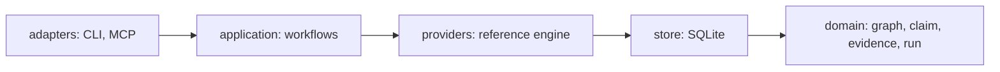

# CompareGraph

**Many cloned repositories, one taxonomy, evidence on every cell.**

[](LICENSE)


<!-- Cargo.toml: license = "Apache-2.0", rust-version = "1.85"; crates/comparegraph/src/adapters/mcp.rs: 17 tools. Languages 29: reference/mod.rs capabilities() lists 32 ids = 29 languages (tsx, jsx, mjs fold into typescript/javascript). Agents 6: application/setup.rs clients. CI badge: add when .github/workflows/ci.yml lands. -->

CompareGraph parses many cloned repositories into one SQLite graph. It scores each clone against
a taxonomy (a "family" of features) and records, per clone and feature, a verdict with a
citation to a file and line range. It is a single Rust binary with a CLI and an MCP server.
It reads clones and never runs them. It never calls a model.

## Contents

- [Why CompareGraph](#why-comparegraph)
- [Get started](#get-started)
- [Uninstall](#uninstall)
- [Supported agents](#supported-agents)
- [Supported platforms](#supported-platforms)
- [Local only, no telemetry, verified releases](#local-only-no-telemetry-verified-releases)
- [How it works](#how-it-works)
- [Measured coverage](#measured-coverage)
- [What you get](#what-you-get)
- [CLI reference](#cli-reference)
- [MCP tools](#mcp-tools)
- [Library usage](#library-usage)
- [Configuration](#configuration)
- [Languages](#languages)
- [The vault](#the-vault)
- [Families and the method](#families-and-the-method)
- [Troubleshooting](#troubleshooting)
- [FAQ and comparisons](#faq-and-comparisons)
- [Design notes, contributing, licence](#design-notes-contributing-licence)

## Why CompareGraph

The problem:

- You have many open-source repositories and one question: who has what?
- Reading each by hand does not scale, and a summary without a line number cannot be checked.
- Notes go stale when the code changes, and nobody notices.

What no code graph does:

| Need | Single-repo code graph | CompareGraph |
|---|---|---|
| Compare several repos on one feature list | no, one repo per index | yes: `family`, `relate`, `matrix` |
| Keep the evidence beside the verdict | no | yes: a claim stores `path:start-end` and a content hash |
| Refuse a claim it cannot support | no | yes: `has` and `partial` need a citation that resolves now; `none` needs a search the engine ran |
| Show what changed after the code moved | no | yes: `check` marks a moved citation stale; the matrix shows `unknown*` |
| Keep a trail of who said what | no | yes: claims and decisions are append-only |

Who it is for: teams comparing their product with the field, due diligence on a set of projects, a newcomer mapping a
field (`family propose` drafts the taxonomy), and coding agents that need compact, token-cheap facts over MCP.

## Get started

### 1. Install

```bash
cargo install --git https://github.com/nicholasandreasujitno/comparegraph comparegraph
```

`npm i -g comparegraph` arrives with the first release. Until then, build from source with Rust 1.85 or newer.

### 2. Wire up your agent

```bash
comparegraph setup --client claude            # dry run: prints the plan, writes nothing
comparegraph setup --client claude --apply    # writes the entry, backs up the old file
```

| Client | Command |
|---|---|
| Claude Code | `comparegraph setup --client claude --apply` |
| Codex | `comparegraph setup --client codex --apply` |
| Cursor | `comparegraph setup --client cursor --scope project --apply` |
| Gemini CLI | `comparegraph setup --client gemini --apply` |
| OpenCode | `comparegraph setup --client opencode --apply` |
| Hermes | `comparegraph setup --client hermes --apply` |

`--client all` acts only on clients that look installed. Check the result with `comparegraph doctor`.

### 3. Add and build your first clones

```bash
comparegraph add ../tiny --name tiny       # register a clone (read, never run)
comparegraph build tiny                    # parse it: one run, one store hash
comparegraph search parse_config --repo tiny
comparegraph show tiny "src/a.py::parse_config"   # callers, callees, community, licence lane
```

### 4. Compare

```bash
comparegraph family add families/example-code-graph-tools   # load a taxonomy pack
comparegraph relate                                         # related | adjacent | unrelated
comparegraph map tiny example-code-graph-tools              # candidate symbols per feature (writes nothing)
comparegraph claim tiny symbols.extraction has --author me --at src/a.py:1-2
comparegraph matrix example-code-graph-tools                # features x clones, prevalence, gaps
comparegraph export vault --out ./vault                     # then open ./vault in Obsidian
```

Every command prints one JSON envelope (add `--pretty` to indent it). Real output from a 9-line Python file, trimmed:

| Command | Shape of `data` |
|---|---|
| `build` | `{"run":1,"nodes":5,"edges":6,"files_parsed":1,"communities":1,"store_hash":"4606fbda..."}` |
| `search` | `items[]` with `qualified_name`, `kind`, `path`, `line_start`, `line_end`, `score`, `"label":"candidate"` |
| `show` | `node`, `community`, `callers[]`, `callees[]`, `stale`, `confidence` |
| `claim` | `verdict`, `confidence:"derived"`, `author`, `locations[]` with `content_hash` and `stale:false` |
| `matrix` | `columns[]`, `rows[]` with `cells[]`, `prevalence`, `gap`, `differentiator` |
| `export vault` | `{"written":"./vault","repos":1,"files":21,"communities":1,"symbols":4}` |

## Uninstall

Remove the `comparegraph` entry from each client you set up, then delete the workspace store.

| Client | File | Remove |
|---|---|---|
| Claude Code | `~/.claude.json` or `.mcp.json` | `mcpServers.comparegraph` |
| Codex | `~/.codex/config.toml` or `.codex/config.toml` | the `[mcp_servers.comparegraph]` table |
| Cursor | `.cursor/mcp.json` (or `~/.cursor/mcp.json`) | `mcpServers.comparegraph` |
| Gemini CLI | `~/.gemini/settings.json` or `.gemini/settings.json` | `mcpServers.comparegraph` |
| OpenCode | `~/.config/opencode/opencode.json` or `opencode.json` | `mcp.comparegraph` |
| Hermes | `~/.hermes/config.yaml` | `mcp_servers.comparegraph` |

`setup --apply` leaves a backup named `<file>.bak-<unix-seconds>` next to every file it changed. Then:

```bash
cargo uninstall comparegraph
rm -r .comparegraph      # in each workspace: the SQLite store
```

<!-- b1-report.md "Verified config shapes" and "Behaviour" (backup name) -->

## Supported agents

`comparegraph setup` writes the entry; `comparegraph doctor` reports each client's state.

| Agent | Config path (user / project) | Entry shape | Verified from |
|---|---|---|---|
| Claude Code | `~/.claude.json` / `.mcp.json` | `mcpServers.<name> = {command, args}` | documented Claude Code MCP config |
| Codex | `~/.codex/config.toml` / `.codex/config.toml` | `[mcp_servers.<name>]` | developers.openai.com/codex/mcp |
| Cursor | `~/.cursor/mcp.json` (unverified, skipped) / `.cursor/mcp.json` (verified) | `mcpServers.<name>` | cursor.com/docs/mcp |
| Gemini CLI | `~/.gemini/settings.json` / `.gemini/settings.json` | `mcpServers.<name>` | gemini-cli docs/tools/mcp-server.md |
| OpenCode | `~/.config/opencode/opencode.json` / `opencode.json` | `mcp.<name> = {type:"local", command:[...]}` | opencode.ai/docs/mcp-servers |
| Hermes | `~/.hermes/config.yaml` (no project scope) | `mcp_servers.<name> = {command, args}` | hermes-agent.nousresearch.com docs, features/mcp |

<!-- b1-report.md "Verified config shapes (docs fetched 2026-10-13)" and "B1 fix round 1" R4 (Cursor user scope unverified, skipped) -->

`doctor` state names:

| State | Meaning |
|---|---|
| `aligned` | the entry matches this workspace and binary |
| `stale` | same arguments, different binary path; `--force` refreshes it |
| `conflict` | the entry differs in another way, or the file cannot be parsed; untouched without `--force` |
| `missing` | no `comparegraph` entry |
| `unverified` | the client's config location is not verified; setup skips it |

## Supported platforms

| Platform | Status |
|---|---|
| linux-x64 | built and tested here |
| darwin-arm64, darwin-x64, win32-x64 | built by the release workflow; untested until the first release |
| Anywhere Rust 1.85+ runs | build from source with `cargo install` |

## Local only, no telemetry, verified releases

- The engine makes no network call. It reads clones on disk and the MCP server speaks over stdio.
- The store is one SQLite file you own: `.comparegraph/comparegraph.db`.
- `comparegraph check` proves that every stored location still resolves and that a rebuild gives the same hash.
- Release checksums are planned. They do not exist yet.

## How it works

```mermaid
flowchart LR
    clones["cloned repos"] --> engine["reference engine: tree-sitter"]
    engine --> store[("SQLite store, schema v1")]
    store --> graph["communities, search, graph queries"]
    store --> families["families: taxonomy packs"]
    families --> relate["relate and map"]
    relate --> claims["claims with citations"]
    claims --> matrix["matrix: gaps, differentiators"]
    graph --> out["exports and MCP"]
    matrix --> out
    claims --> out
```

The code is arranged in rings. Dependencies point inward. The folders under `crates/comparegraph/src/` carry the same names.



<!-- docs/superpowers/specs/2026-10-12-codecross-design.md section 3 (the rings) -->

### The three rules

1. **The engine never calls a model.** Every score, band, description and candidate is computed from stored facts.
2. **A claim needs a citation that resolves now.** `has` and `partial` need `--at path:start-end` that matches a
   stored node. `none` needs `--searched` terms that find nothing in the engine's own index. Otherwise the engine
   refuses, or writes `unknown`.
3. **Claims and decisions are append-only, enforced by the database.** A change is a new row that names the one it
   supersedes. The latest row wins, and the trail stays.

<!-- docs/superpowers/specs/2026-10-12-codecross-design.md sections 2b, 4, 5 -->

Every answer carries `confidence` (`observed`, `derived`, `inferred`, `unknown`) and a `limitations[]` list of what
the engine cannot see. A candidate from `search` or `map` is labelled `candidate`, never `has`.

## Measured coverage

Two reports in this repository are the source of every number here. Read their caveats before quoting one.

- [`docs/reports/2026-10-12-engine-parity.md`](docs/reports/2026-10-12-engine-parity.md): CompareGraph against
  code-review-graph 2.3.9 on three upstream projects.
- [`docs/reports/2026-10-12-plan-1-proof.md`](docs/reports/2026-10-12-plan-1-proof.md): three real clones through the pipeline.
- Re-run the comparison yourself: [`scripts/compare-engines.sh`](scripts/compare-engines.sh).

### Conformance per language

`comparegraph conform reference` runs the golden fixtures in `fixtures/`. A provider below the floor is refused:
nodes need recall and precision of at least 0.95, edges at least 0.85.

| Fixture | Node recall / precision | Edge recall / precision |
|---|---|---|
| go | 1.00 / 1.00 | 1.00 / 1.00 |
| java | 1.00 / 1.00 | 1.00 / 1.00 |
| python | 1.00 / 1.00 | 0.952 / 1.00 |
| rust | 1.00 / 1.00 | 1.00 / 1.00 |
| typescript | 1.00 / 1.00 | 0.955 / 1.00 |

<!-- output of `comparegraph conform reference` at this commit (fixtures/*/expected.json); floors: docs/superpowers/specs/2026-10-12-codecross-design.md section 7 -->

Five fixtures are five small repositories. They prove the extractors against a hand-checked graph, not every
language feature.

### Overlap with code-review-graph

Jaccard over nodes keyed `(path, name)` and over resolved edges. Release build at `3afed80`, `nice -n 10`, seed 7,
one run on one shared host. Symbols and extends/implements are from the earlier run at `4e00187`.

| Measure | graphmind (Rust + TS) | srclight (Python) | code-review-graph (Python + TS) |
|---|---|---|---|
| Symbols (function, method, class, type) | 0.946 | 0.988 | 0.939 |
| Calls, resolved | 0.713 | 0.969 | 0.963 |
| Imports, file to file | 0.647 | 0.904 | 0.901 |
| Tests (test to tested symbol) | 0.119 | 0.605 | 0.513 |
| Extends and implements | 0.938 (15 vs 16 edges) | 0.667 (9 vs 6) | 0.730 (32 vs 32) |
| Call edges only they have / only we have | 265 / 736 | 14 / 89 | 364 / 69 |
| Our call edges below confidence 1.0 | 66 (2.0 percent) | 14 (0.4) | 199 (1.8) |

<!-- docs/reports/2026-10-12-engine-parity.md#after-the-review-fixes-2026-10-13: calls "0.712 to 0.713 | 0.969 to 0.969 | 0.960 to 0.963"; imports "0.647 | 0.904 | 0.901"; tests "0.118 to 0.119 | 0.605 | 0.512 to 0.513"; edge counts "265 / 739 to 265 / 736 | 14 / 89 to 14 / 89 | 385 / 78 to 364 / 69"; 0.5 share "6 (0.2 pct) to 66 (2.0) | 9 (0.3) to 14 (0.4) | 51 (0.5) to 199 (1.8)" -->
<!-- docs/reports/2026-10-12-engine-parity.md#after-the-precision-and-recall-pass-2026-10-13: symbols "0.946 to 0.946 | 0.988 to 0.988 | 0.854 to 0.939"; extends "0.938 | 0.667 | 0.730"; edge counts 15 vs 16, 9 vs 6, 32 vs 32 from the first edges table -->

The limit: code-review-graph resolves only 16 to 35 percent of its own call targets to an indexed node, so each edge
Jaccard is over the comparable minority.
<!-- docs/reports/2026-10-12-engine-parity.md#what-is-compared-and-its-limit -->

Precision, as samples read by hand at `4e00187` by one reader:

| Sample | Result |
|---|---|
| 30 call edges only CompareGraph has (10 per project) | 26 correct, 2 false, 2 ambiguous |
| 54 call edges only code-review-graph has | 43 our misses, 10 their false edges, 1 ambiguous |

<!-- docs/reports/2026-10-12-engine-parity.md#samples-read-by-hand: "total of 30 | 26 | 2 | 2"; "total of 54 | 43 | 10 | 1" -->

These are samples, not rates. The review fixes after them (`3afed80`) were not re-read by hand. The report says so.

### Build time

Seconds, median of 3 cold builds, same host and nice level. code-review-graph's figure includes Python start-up and its
flows and community post-processing. CompareGraph's includes communities.

| Project | code-review-graph full | CompareGraph cold | CompareGraph unchanged rebuild |
|---|---|---|---|
| graphmind (251 files) | 6.03 | 2.30 | 2.09 |
| srclight (100 files) | 5.34 | 1.12 | 1.01 |
| code-review-graph (470 files) | 16.67 | 5.16 | 4.34 |

<!-- docs/reports/2026-10-12-engine-parity.md#after-the-review-fixes-2026-10-13: "Cold build medians on the busy host: 2.30 / 1.12 / 5.16 s against code-review-graph's 6.03 / 5.34 / 16.67 s."; unchanged rebuild from the 4e00187 table "2.09 / 1.01 / 4.34"; files from the first build table -->

Caveats: a shared host, run-to-run variation of 5 to 15 percent, and no query latency or answer quality measured on
real tasks. Treat the table as one machine's timings, not a speed-up claim.

### The pipeline on three clones

Release build, fresh workspace, one build per clone.

| Clone | Build s | File nodes | Communities | Files in the largest community |
|---|---|---|---|---|
| graphmind | 0.71 | 174 | 40 | 32 (18.4 percent) |
| srclight | 0.53 | 38 | 11 | 19 (50.0 percent) |
| code-review-graph | 4.00 | 161 | 46 | 50 (31.1 percent) |

<!-- docs/reports/2026-10-12-plan-1-proof.md#plan-2: "graphmind ... | 0.71 | 174 | 40 | 32 (18.4%) |" and the two rows below it -->

Vault of all three clones: 12,722 files, 52 MB, 0.67 s. With family, feature and claim pages: 12,753 files, 0.70 s. A
second build gave the same store hash on all three.
<!-- docs/reports/2026-10-12-plan-1-proof.md#plan-2 "12722 files, 52 MB, 0.67 s"; #plan-3 "12753 files, 0.70 s"; Plan 1 table "hash equal on rerun yes" -->

srclight stays at 50 percent: its 38 files sit in one package directory, which the directory split cannot divide.

Behind code-review-graph: call recall on Rust and TS/JSX, test links (Jaccard 0.119 to 0.605), semantic search,
execution flows, diff-aware review. The graph is rewritten each run; unchanged files reuse a parse cache.
<!-- docs/reports/2026-10-12-engine-parity.md "Verdict per area, now" -->

## What you get

Four levels. Each answer says how it knows.

| Level | Example | Where |
|---|---|---|
| Repo surface | licence, licence lane, head commit, role (root or comparator) | `repos`, `show` |
| Structure | module communities with label, keywords, cohesion, size | `communities` |
| Symbols | callers, callees, blast radius, tests that reach a symbol, entry points, dead-code candidates | `show`, `traverse`, `impact`, `tests-for`, `entry-points`, `dead-code` |
| Claims | verdict, citation, author, trail of superseded rows | `claim`, `claims`, `matrix` |

A real `show` answer from the quick start (trimmed):

```json
{"ok":true,"verb":"show","schema":1,
 "data":{"repo":"tiny","licence":null,"lane":"study",
  "node":{"kind":"function","qualified_name":"src/a.py::parse_config",
          "path":"src/a.py","line_start":1,"line_end":2,"language":"python"},
  "community":"src/a.py","callers":["src/a.py::push"],"callees":["src/a.py::load"],
  "stale":false,"confidence":"observed"},
 "evidence":{"confidence":"observed","limitations":[]},
 "cost":{"rows":1,"bytes":434}}
```

Envelope fields: `ok`, `verb`, `schema`, `data`, `evidence`, `page`, `cost`, `error`. The exit code is 0 when `ok`
and 1 otherwise. List verbs take `--limit` (default 50, maximum 500) and `--cursor`. Error codes: `store_error`,
`provider_unavailable`, `not_found`, `empty`, `below_floor`, `check_failed`, `io_error`.

## CLI reference

Global options on every command: `--root <ROOT>` (the workspace, default `.`) and `--pretty`.
Each table row is a command listed by `comparegraph --help`. The `--help` text of the commands with flags is in the blocks below.

### Build and inspect

| Command | What it does | Flags that matter |
|---|---|---|
| `add <PATH>` | Register a clone. Read, never run. | `--name`, `--as-root` |
| `build <REPO>` | Parse a clone into the graph (one run). | `--provider` (default `reference`), `--max-file-bytes`, `--max-files`, `--full` (bypass the parse cache) |
| `check` | Verify schema, determinism and citation locations. | none |
| `repos` | Registered repos with their latest run. | none |
| `doctor` | Report the store, every provider and each agent client's registration. | `--bin` |
| `conform <PROVIDER>` | Run the golden fixtures against a provider. | `--fixtures` |

<details>
<summary><code>comparegraph add</code></summary>

```text
Register a clone (read, never run)
Usage: comparegraph add [OPTIONS] <PATH>
  <PATH>  
      --name <NAME>  
      --as-root      register this clone as the workspace's root (spec §2b product/baseline modes)
```
</details>
<details>
<summary><code>comparegraph build</code></summary>

```text
Parse a registered clone into the graph (one run)
Usage: comparegraph build [OPTIONS] <REPO>
  <REPO>  
      --provider <PROVIDER>              [default: reference]
      --max-file-bytes <MAX_FILE_BYTES>  [default: 1048576]
      --max-files <MAX_FILES>            [default: 50000]
      --full                             bypass the per-file parse cache
```
</details>
<details>
<summary><code>comparegraph doctor</code></summary>

```text
Report the store, every provider and each agent client's registration of the MCP server
Usage: comparegraph doctor [OPTIONS]
      --bin <BIN>  compare registrations against this command instead of the running executable
```
</details>
<details>
<summary><code>comparegraph conform</code></summary>

```text
Run the golden fixtures against a provider
Usage: comparegraph conform [OPTIONS] <PROVIDER>
  <PROVIDER>  
      --fixtures <FIXTURES>  [default: fixtures]
```
</details>


### Graph queries

| Command | What it does | Flags that matter |
|---|---|---|
| `search <QUERY>` | Full-text search over symbols of each latest run. | `--repo`, `--kind`, `--limit`, `--cursor` |
| `show <REPO> <QUALIFIED_NAME>` | A symbol with callers, callees, community, licence lane. | `--detail full` adds its current lines |
| `communities <REPO>` | Module clusters of the latest run. | `--limit`, `--cursor` |
| `traverse <REPO> <QUALIFIED_NAME>` | Nodes reachable over calls, extends, implements, with hop distance and path. | `--direction`, `--depth` (3), `--max-nodes` (200), `--kinds`, `--min-confidence` (0.5) |
| `impact <REPO> [QUALIFIED_NAME]` | Everything that transitively depends on a symbol or files, by hop, plus the tests that reach it. | `--file`, `--depth` (5), `--max-nodes` (500), `--min-confidence` |
| `tests-for <REPO> <QUALIFIED_NAME>` | Tests linked directly or through at most 3 call hops. | `--max-nodes`, `--min-confidence` |
| `entry-points <REPO>` | Exported, handler or main symbols nothing calls. | `--limit`, `--cursor`, `--min-confidence` |
| `dead-code <REPO>` | Candidates nothing references. Dynamic dispatch is invisible. | `--limit`, `--cursor`, `--min-confidence` |

<details>
<summary><code>comparegraph search</code></summary>

```text
Full-text search over symbols of each repo's latest run
Usage: comparegraph search [OPTIONS] <QUERY>
  <QUERY>  
      --repo <REPO>      
      --kind <KIND>      
      --limit <LIMIT>    [default: 50]
      --cursor <CURSOR>  
```
</details>
<details>
<summary><code>comparegraph show</code></summary>

```text
A symbol with callers, callees, community, licence lane; --detail full adds its current lines
Usage: comparegraph show [OPTIONS] <REPO> <QUALIFIED_NAME>
  <REPO>            
  <QUALIFIED_NAME>  
      --detail <DETAIL>  
```
</details>
<details>
<summary><code>comparegraph communities</code></summary>

```text
Module clusters of a repo's latest run
Usage: comparegraph communities [OPTIONS] <REPO>
  <REPO>  
      --limit <LIMIT>    [default: 50]
      --cursor <CURSOR>  
```
</details>
<details>
<summary><code>comparegraph traverse</code></summary>

```text
Nodes reachable from a symbol over calls/extends/implements, with hop distance and the path to each
Usage: comparegraph traverse [OPTIONS] <REPO> <QUALIFIED_NAME>
  <REPO>            
  <QUALIFIED_NAME>  
      --direction <DIRECTION>            [default: both]
      --depth <DEPTH>                    [default: 3]
      --max-nodes <MAX_NODES>            [default: 200]
      --kinds <KINDS>                    [default: calls,extends,implements]
      --min-confidence <MIN_CONFIDENCE>  [default: 0.5]
```
</details>
<details>
<summary><code>comparegraph impact</code></summary>

```text
Everything that transitively depends on a symbol or file(s), by hop, plus the tests that reach it
Usage: comparegraph impact [OPTIONS] <REPO> [QUALIFIED_NAME]
  <REPO>            
  [QUALIFIED_NAME]  
      --file <FILE>                      
      --depth <DEPTH>                    [default: 5]
      --max-nodes <MAX_NODES>            [default: 500]
      --min-confidence <MIN_CONFIDENCE>  [default: 0.5]
```
</details>


### Families and claims

| Command | What it does | Flags that matter |
|---|---|---|
| `family add <DIR>` | Load a pack (`rows.md`). Features it no longer lists become retired. | |
| `family list` / `family show` | Registered families; one family by group. | |
| `family propose` | Write a draft `rows.draft.md` from terms the given repos share. No model. | `--repos a,b,c`, `--min-repos`, `--max`, `--out` |
| `relate` | Score each clone against each family and record the band. | `--repo`, `--family`, `--stored` (read, compute nothing) |
| `map <REPO> <FAMILY>` | Candidate symbols and communities per feature. Writes nothing. | `--feature`, `--limit` (5) |
| `claim <REPO> <FEATURE> <VERDICT>` | Record `has`, `partial`, `none` or `unknown`. | `--author` (required), `--at path:start-end`, `--searched`, `--note`, `--family` |
| `claims` | Latest claim per clone and feature. | `--repo`, `--family`, `--feature`, `--history` |
| `decide <REPO> <DISPOSITION>` | Record `adopt`, `reject` or `park`. Append-only. | `--why`, `--by` (both required), `--feature`, `--family` |
| `decisions` | Latest decision per scope. | `--repo`, `--history` |
| `matrix <FAMILY>` | Features against every clone: verdicts, prevalence, gaps, differentiators. | |

<details>
<summary><code>comparegraph family propose</code></summary>

```text
Write a draft taxonomy (rows.draft.md) from the terms the given repos share; no model
Usage: comparegraph family propose [OPTIONS] --repos <REPOS> <NAME>
  <NAME>  
      --repos <REPOS>          
      --out <OUT>              
      --min-repos <MIN_REPOS>  [default: 2]
      --max <MAX>              [default: 60]
```
</details>
<details>
<summary><code>comparegraph relate</code></summary>

```text
Score each clone against each family (related|adjacent|unrelated) and record the band
Usage: comparegraph relate [OPTIONS]
      --repo <REPO>      
      --family <FAMILY>  
      --stored           read the latest stored rows; compute and record nothing
```
</details>
<details>
<summary><code>comparegraph map</code></summary>

```text
Candidate symbols and communities per feature of a family in one clone; writes nothing
Usage: comparegraph map [OPTIONS] <REPO> <FAMILY>
  <REPO>    
  <FAMILY>  
      --feature <FEATURE>  
      --limit <LIMIT>      [default: 5]
```
</details>
<details>
<summary><code>comparegraph claim</code></summary>

```text
Record a claim (has|partial|none|unknown) about a feature in a clone, with citations that resolve now
Usage: comparegraph claim [OPTIONS] --author <AUTHOR> <REPO> <FEATURE> <VERDICT>
  <REPO>     
  <FEATURE>  
  <VERDICT>  
      --author <AUTHOR>      
      --family <FAMILY>      
      --at <AT>              
      --searched <SEARCHED>  
      --note <NOTE>          
```
</details>
<details>
<summary><code>comparegraph claims</code></summary>

```text
Latest claim per (clone, feature); --history lists every row with its supersede chain
Usage: comparegraph claims [OPTIONS]
      --repo <REPO>        
      --family <FAMILY>    
      --feature <FEATURE>  
      --history            
```
</details>
<details>
<summary><code>comparegraph decide</code></summary>

```text
Record a decision (adopt|reject|park) about a clone, or one feature of it; append-only
Usage: comparegraph decide [OPTIONS] --why <WHY> --by <BY> <REPO> <DISPOSITION>
  <REPO>         
  <DISPOSITION>  
      --why <WHY>          
      --by <BY>            
      --feature <FEATURE>  
      --family <FAMILY>    disambiguates --feature when its id exists in several families
```
</details>
<details>
<summary><code>comparegraph matrix</code></summary>

```text
Active features of a family against every clone: verdicts, prevalence, gaps and differentiators
Usage: comparegraph matrix <FAMILY>
  <FAMILY>  
```
</details>


### Exports and agents

| Command | What it does | Flags that matter |
|---|---|---|
| `export json` | The graph as JSON. | `--repo` |
| `export vault` | An Obsidian-style markdown vault, regenerated whole. | `--out` |
| `mcp` | Serve the read verbs over MCP stdio (JSON-RPC, one object per line). | |
| `setup` | Register the MCP server with agent clients. A plan by default. | `--client`, `--scope`, `--apply`, `--force`, `--bin` |

<details>
<summary><code>comparegraph export vault</code></summary>

```text
An Obsidian-style markdown vault, regenerated whole
Usage: comparegraph export vault --out <OUT>
      --out <OUT>  
```
</details>
<details>
<summary><code>comparegraph setup</code></summary>

```text
Register the MCP server with agent clients: a plan by default, `--apply` writes (additive, backed up)
Usage: comparegraph setup [OPTIONS]
      --client <CLIENT>  claude, codex, cursor, gemini, opencode, hermes, or all (installed clients only) [default: all]
      --scope <SCOPE>    user (the client's own config) or project (the current directory) [default: user]
      --apply            
      --force            replace a `comparegraph` entry that differs: another workspace or shape (conflict) or a moved binary (stale); both are left untouched without it
      --bin <BIN>        the command to register (default: this binary)
```
</details>


## MCP tools

`comparegraph mcp` speaks JSON-RPC 2.0 over stdio, one object per line, protocol `2025-06-18`. Every tool returns the
same envelope as the CLI. Seventeen tools: sixteen read-only, one write.
<!-- crates/comparegraph/src/adapters/mcp.rs: tools() lists 17 -->

| Tool | Answers | Key arguments |
|---|---|---|
| `comparegraph_repos` | Which repos, with licence, lane, role, head and latest run | none |
| `comparegraph_search` | Which symbols match these words | `query`, `repo`, `kind`, `limit`, `cursor` |
| `comparegraph_show` | One symbol: callers, callees, community, licence lane | `repo`, `qualified_name`, `detail` (`compact` or `full`) |
| `comparegraph_communities` | Module clusters of a repo | `repo`, `limit`, `cursor` |
| `comparegraph_check` | Is the store sound | none |
| `comparegraph_families` | Which families, with feature counts | none |
| `comparegraph_map` | Candidate symbols and communities per feature | `repo`, `family`, `feature`, `limit` |
| `comparegraph_relate` | Stored relatedness band per clone and family (reads, does not compute) | `repo`, `family` |
| `comparegraph_claims` | Latest claim per clone and feature, with citations | `repo`, `family`, `feature`, `history` |
| `comparegraph_matrix` | Features against clones, prevalence, gaps, differentiators | `family` |
| `comparegraph_claim` | **Write.** Record a claim | `repo`, `feature`, `verdict`, `author`, `at[]`, `searched`, `note`, `family` |
| `comparegraph_traverse` | Reachable nodes with hop distance and path confidence | `repo`, `qualified_name`, `direction`, `depth` (max 10), `max_nodes` (max 2000), `kinds`, `min_confidence` |
| `comparegraph_impact` | Blast radius by hop, plus the tests that reach it | `repo`, `qualified_name` or `files[]`, `depth`, `max_nodes`, `min_confidence` |
| `comparegraph_tests_for` | Tests linked to a symbol | `repo`, `qualified_name`, `max_nodes`, `min_confidence` |
| `comparegraph_entry_points` | Exported, handler or main symbols nothing calls | `repo`, `limit`, `cursor`, `min_confidence` |
| `comparegraph_dead_code` | Dead-code candidates (never proof) | `repo`, `limit`, `cursor`, `min_confidence` |
| `comparegraph_doctor` | Store and provider status | none |

There is no `decide` tool. Adopting or rejecting a clone is a human act on the CLI.
<!-- docs/design-notes-for-review.md: "no MCP decide tool" -->

`min_confidence` is `0.5` or `1.0`. The default is `0.5`, which includes guessed hops. A guessed hop is labelled in
`evidence`, and `1.0` drops them. A name-only match is capped at `0.5` and never binds onto a method.
Truncation (`depth`, `max_nodes`) is recorded in `evidence.limitations`.
<!-- docs/design-notes-for-review.md Plan 4: "MCP default min_confidence 0.5 includes guessed hops (labelled in evidence)"; "name-only binds ... capped at 0.5 and never bind a method" -->

### Client setup

```bash
comparegraph setup --client claude --apply
```

`--client` takes `claude`, `codex`, `cursor`, `gemini`, `opencode`, `hermes` or `all` (installed clients only).
Without `--apply` it prints the plan and writes nothing. With it, the change is additive and the old file is backed up.
A differing `comparegraph` entry (another workspace, or a moved binary) is left alone unless you pass `--force`.
`--scope` is `user` (the client's own config) or `project` (the current directory). Cursor user scope is unverified.
`comparegraph doctor` reports each client's registration. A development build refuses to register itself; pass
`--bin <installed path>`.

By hand, add this to `.mcp.json`:

```json
{"mcpServers":{"comparegraph":{"command":"comparegraph","args":["--root","/path/to/workspace","mcp"]}}}
```

## Library usage

The crate is `comparegraph`. Each verb is a function in `comparegraph::application::*` that takes the workspace root
and returns a typed result. The CLI and MCP server are thin adapters over them.

```rust
use comparegraph::application::{add, build, matrix};
use comparegraph::providers::BuildOptions;
use std::path::Path;

let root = Path::new(".");
add::add_repo(root, Path::new("../tiny"), Some("tiny"), false)?;
let report = build::build_repo(root, "tiny", "reference", &BuildOptions::default())?;
let m = matrix::matrix(root, "example-code-graph-tools")?;
println!("{} nodes, {} comparators", report.nodes, m.comparators);
```

<!-- crates/comparegraph/src/application/{add.rs:40 add_repo, build.rs:36 build_repo, matrix.rs:42 matrix}; providers/mod.rs BuildOptions::default; modules listed in application/mod.rs -->

| Contract | Use it for |
|---|---|
| The JSON envelope (`export json`, every CLI answer) | the stable data contract; fields in [What you get](#what-you-get) |
| [`crates/comparegraph/src/store/schema.sql`](crates/comparegraph/src/store/schema.sql) | direct read-only SQL on `.comparegraph/comparegraph.db` |

`claim` and `decision` rows are append-only. Read them; do not update them.

## Configuration

| Setting | Where | Meaning |
|---|---|---|
| `--root <dir>` | every command (default `.`) | the workspace; the store is `<root>/.comparegraph/comparegraph.db` |
| `--pretty` | every command | indent the JSON |
| `COMPAREGRAPH_BIN` | environment | the command `setup` registers, when `--bin` is not given |
| `COMPAREGRAPH_NOW` | environment | a fixed clock for tests (a test hook; do not set it in real use) |
| `--min-confidence` | `traverse`, `impact`, `tests-for`, `entry-points`, `dead-code` | `0.5` (default, includes guessed hops) or `1.0` |
| `--max-file-bytes` | `build` | skip files over this size (default 1048576) |
| `--max-files` | `build` | keep the first N files by sorted path (default 50000) |
| `--full` | `build` | bypass the per-file parse cache |

Skipped on every build: the directories `node_modules`, `target`, `dist`, `build`, `.git`, `vendor`, `__pycache__`,
`.venv` and `venv`; files that `.gitignore` or `.ignore` exclude; minified files (`*.min.js`, `*.min.css`,
`*.bundle.js`, or a line over 5,000 characters). Skips are counted in the run's `limitations`.
<!-- crates/comparegraph/src/providers/reference/walker.rs: ALWAYS_SKIP, is_minified_name, MINIFIED_LINE_CHARS; setup.rs COMPAREGRAPH_BIN, COMPAREGRAPH_NOW; providers/mod.rs BuildOptions::default -->

## Languages

The reference engine registers 32 language identifiers. TSX counts with TypeScript, and JSX and MJS with
JavaScript, so that is 29 languages.
<!-- crates/comparegraph/src/providers/reference/mod.rs capabilities(): 32 entries -->

| Group | Identifiers | Extracted |
|---|---|---|
| Golden fixtures | `typescript` (+ `tsx`), `python`, `rust`, `go`, `java` | symbols, contains, imports, calls; floors enforced by `conform` |
| Also parsed | `javascript`, `jsx`, `mjs`, `ruby`, `php`, `swift`, `kotlin`, `dart`, `scala`, `c`, `cpp`, `csharp`, `objc`, `perl`, `r`, `bash`, `powershell`, `sql` | symbols and direct calls from the taken extractors |
| Config and markup | `yaml`, `toml`, `hcl`, `dockerfile`, `graphql`, `css`, `scss`, `html` | symbols only; treat as noise for comparison |

| Capability | Languages |
|---|---|
| Inheritance edges (`extends`, `implements`) | `typescript`, `tsx`, `javascript`, `jsx`, `mjs`, `python`, `rust`, `java`, `csharp` |
| No inheritance edges | `go` by design: struct embedding and implicit interfaces are not modelled |
| Context passes (typed receivers, import aliases, test links) | Rust, Python, TypeScript and JavaScript |

<!-- crates/comparegraph/src/providers/reference/inherit.rs match arms; fixtures/go/NOTES.md; docs/reports/2026-10-12-engine-parity.md "recall pass" -->

"Symbol-only" means the file yields symbols and the direct calls its extractor reports, but no type-aware call
binding, no import resolution beyond names, and no inheritance. Known gaps: a Java `new T()` has no call site, and a
trait method and its impl method share one qualified name in Rust. Config files such as `Cargo.toml` become symbols.
<!-- docs/design-notes-for-review.md Plan 4 and Open items -->

## The vault

`comparegraph export vault --out ./vault` regenerates the whole vault from the store.

```text
vault/
  index.md           entry point: counts every note group
  llms.txt           a short map for agents
  AGENTS.md          the short workflow for an agent in this vault
  repos/             one note per clone
  communities/       one folder per clone, one note per community
  symbols/           one folder per clone, one note per symbol
  families/          one note per family
  features/          one folder per family, one note per feature, with its cells
  history/           one note per clone: dated claim and decision trail, superseded rows marked
```

Every note starts with a front matter block that has a one-line `description:` built from stored facts by a
template, not by a model:

```text
description: "function src/a.py::parse_config in src/a.py:1-2, 1 callers, 1 callees"
```

An agent reads the descriptions first and opens a note only when the line is not enough.

<!-- screenshot: Obsidian graph view of a 3-repo vault — add when available -->

## Families and the method

A family is a directory with a `rows.md` file: front matter with `family:` and `description:`, then a table. Example:
[`families/example-code-graph-tools/rows.md`](families/example-code-graph-tools/rows.md).

| Column | Meaning |
|---|---|
| `id` | stable key, such as `graph.call-graph` |
| `group`, `feature` | where it sits and what it is called |
| `definition` | one sentence |
| `counts_as_has` | what evidence earns a `has` |
| `tier`, `weight` | `basics`, `common`, `extra` or `candidate`; a number |

`family propose <name> --repos a,b,c` drafts a pack from the terms the clones share and writes `rows.draft.md`.
It uses no model. In the three-clone proof it returned 60 candidate terms and stopped at its `--max 60` cap.
<!-- docs/reports/2026-10-12-plan-1-proof.md#plan-3: "returned 60 candidate terms (the default --max 60 cap ...)" -->

The tier names and the band thresholds (`related` at 0.5 or more, `adjacent` at 0.2 or more) are provisional. A
relatedness score is vocabulary overlap, not evidence: in the proof all three clones scored 0.9 to 1.0 against the
example pack, and the bands do not tell close cousins apart.
<!-- docs/design-notes-for-review.md; docs/reports/2026-10-12-plan-1-proof.md#plan-3 relatedness table -->

### The method: six skills

Plain markdown in [`method/`](method). Any agent can read them. Each gives when to use the verb, the exact
commands, what the engine refuses, and how to check.

| Skill | One line |
|---|---|
| [`adding-a-clone`](method/adding-a-clone/SKILL.md) | Register a clone as a comparator or the root, parse it, verify the build. |
| [`defining-a-family`](method/defining-a-family/SKILL.md) | Write a pack, seed one with `family propose`, reload it safely. |
| [`mapping-features`](method/mapping-features/SKILL.md) | Find candidate evidence and score relatedness. Candidates are leads, never verdicts. |
| [`writing-a-claim`](method/writing-a-claim/SKILL.md) | Record has, partial, none or unknown with citations that resolve now. |
| [`recording-a-decision`](method/recording-a-decision/SKILL.md) | Record a person's adopt, reject or park with their name and reason. |
| [`reading-the-vault`](method/reading-the-vault/SKILL.md) | Read the matrix, the vault and the JSON export, and read gaps correctly. |

Plugin install (the manifest ships with lane B3; the line is what it will be):

```text
/plugin install comparegraph
```

## Troubleshooting

| Symptom | Cause and fix |
|---|---|
| `no workspace` or `not_found` on a read verb | read verbs never create `.comparegraph`. Run `comparegraph add <clone>` in the workspace first, or pass `--root`. |
| `setup` says "running from a build directory" | a `target/` binary refuses to register itself. Pass `--bin <installed path>` or set `COMPAREGRAPH_BIN`. |
| A claim shows `unknown*` or `stale` after you edited the clone | a location goes stale only when `comparegraph check` runs. Run `check`, rebuild, and write the claim again. |
| `conform` returns `below_floor` | the provider scored under 0.95 on nodes or 0.85 on edges. Fix the provider; the floors do not move. |
| The agent does not see the server | run `comparegraph doctor`. `missing`: run `setup --apply`. `stale` or `conflict`: add `--force`. Restart the client. |
| A large repository is cut short | the run records `truncated_files` or `skipped_oversize`. Raise `--max-files` or `--max-file-bytes` and rebuild. |
| `search` for a word returns 0 hits | search matches whole identifier tokens, so `reader` does not find `ReaderConfig`. Try another stem. |
| `claim ... none` is refused | `none` needs `--searched` terms that find nothing; the engine ran the search and found a hit, or the text had no token. |

<!-- crates/comparegraph/src/store/mod.rs:124 "never creates .comparegraph"; b1-report.md R2 (build-directory refusal); docs/design-notes-for-review.md (stale only at check; none needs --searched); docs/reports/2026-10-12-plan-1-proof.md#plan-2 (reader: 0 hits) -->

## FAQ and comparisons

**How is this different from code-review-graph?**
code-review-graph goes deeper on one repository: embeddings, execution flows, diff-aware review, hub and refactor
tools, and 30 MCP tools. CompareGraph compares many repositories and keeps cited claims. On three projects the two
engines agree closely on symbols and Python calls and differ elsewhere; the numbers are in [Measured coverage](#measured-coverage) and
in the [parity report](docs/reports/2026-10-12-engine-parity.md). The parity report lists multi-repo comparison,
claims and the vault as absent in code-review-graph, and embeddings, flows and diff review as absent here.
<!-- docs/reports/2026-10-12-engine-parity.md "Feature parity": MCP tools 30 vs 17 -->

**How is it different from codegraph, graphmind and codanna?**
They index one repository for navigation and search. CompareGraph's unit of output is a cell in a
features-by-clones matrix, with a citation. Its parser layer is taken from graphmind (MIT).
<!-- docs/superpowers/specs/2026-10-12-codecross-design.md section 6: parser layer taken from graphmind -->

**Does it use an LLM?**
No. Nothing in the engine calls a model. An agent fits in the loop: it reads `map` candidates, opens the cited
lines, and writes the `claim` with its own name as `--author`.

**Can it adopt code for me?**
No. It gives you `path:start-end` and the clone's licence lane. Whether to take the code is a person's decision,
recorded with `decide`.

**How do I add my own engine?**
Implement the `GraphProvider` trait (`name`, `version`, `detect`, `capabilities`, `build`) and pass the golden
fixtures: `comparegraph conform <provider>`. A provider below the floor is refused.
<!-- docs/superpowers/specs/2026-10-12-codecross-design.md sections 6 and 7 -->

**Why are some call edges 0.5?**
A call matched by name only, with no import or declared type to back it, is a guess. It is stored at confidence 0.5.
In the latest run, 0.4 to 2.0 percent of call edges are at 0.5. Queries take `--min-confidence 1.0` to drop them.

**Is my code sent anywhere?**
No. The engine makes no network calls. It reads the clone on disk, writes a SQLite file in the workspace, and the
MCP server speaks over stdio.

**What does it not do?**
It does not diff two versions, run a clone, or infer types. Semantic search, execution flows and diff-aware review
are not built. A `none` claim means a search found nothing, not that the feature is absent.

## Design notes, contributing, licence

- [`docs/design-notes-for-review.md`](docs/design-notes-for-review.md): every provisional choice, with the
  alternative and what would change it.
- [`docs/superpowers/specs/2026-10-12-codecross-design.md`](docs/superpowers/specs/2026-10-12-codecross-design.md): the design.
- Contributing: `CONTRIBUTING.md` arrives with lane B3.
- Third-party code: [`docs/THIRD_PARTY_NOTICES.md`](docs/THIRD_PARTY_NOTICES.md) lists graphmind's parser layer (MIT).
- Licence: Apache-2.0. See [`LICENSE`](LICENSE).
