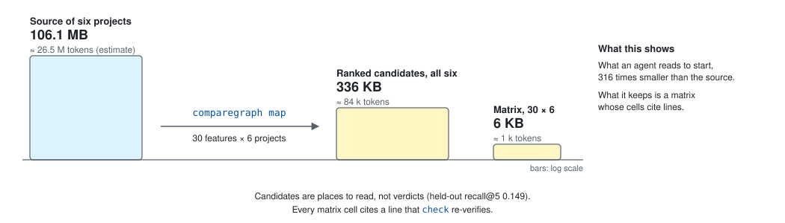
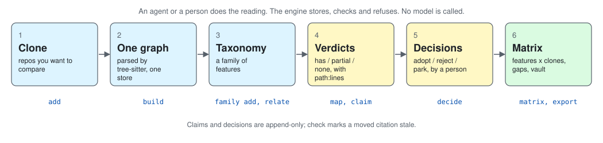
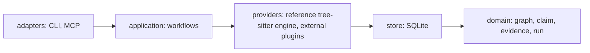

# CompareGraph

**Many cloned repositories, one taxonomy, evidence on every cell.**

[](https://github.com/massrelay-ai/comparegraph/actions/workflows/ci.yml)
[](https://github.com/massrelay-ai/comparegraph/releases/latest)
[](LICENSE)


<!-- sources: Cargo.toml (licence, rust-version); docs/catalog.json (18 tools); walker.rs language_for (29 languages); application/setup.rs (12 clients); .github/workflows/ci.yml -->

CompareGraph parses many cloned repositories into one SQLite graph. It scores each clone against a taxonomy (a "family"
of features) and records, per clone and feature, a verdict with a citation to a file and line range. It is one Rust
binary with a CLI and an MCP server. It reads clones and never runs them. It never calls a model.



Measured on six study copies and 30 features, binary 0.1.1: numbers in [`docs/assets/cost.json`](docs/assets/cost.json), method and caveats in the [answer-size report](docs/reports/2026-10-14-answer-size.md).

## Get started

```bash
curl -fsSL https://raw.githubusercontent.com/massrelay-ai/comparegraph/main/scripts/install.sh | sh   # the binary, checksum-checked (Windows: see Install)
comparegraph setup --apply        # every agent it finds: MCP entry, rules block, Claude Code hook
comparegraph add ../some-clone --name some && comparegraph build some   # a clone in, one graph out
```

Then `family add`, `map`, `claim` and `matrix`: the [Quick start](#quick-start) walks the shipped sample through all of them.

## Contents

- [Get started](#get-started)
- [Why CompareGraph](#why-comparegraph)
- [Install](#install)
- [Quick start](#quick-start)
- [How good is it](#how-good-is-it)
- [Languages](#languages)
- [How it works](#how-it-works)
- [What you get](#what-you-get)
- [CLI reference](#cli-reference)
- [MCP tools](#mcp-tools)
- [Plugins and the second engine](#plugins-and-the-second-engine)
- [Families and the seven skills](#families-and-the-seven-skills)
- [The vault](#the-vault)
- [Configuration](#configuration)
- [Agents, platforms, uninstall](#agents-platforms-uninstall)
- [Library usage](#library-usage)
- [Troubleshooting](#troubleshooting)
- [FAQ](#faq)
- [Roadmap](#roadmap)
- [Documentation](#documentation)
- [Contributing, licence, third-party code](#contributing-licence-third-party-code)

## Why CompareGraph

You have many repositories and one question: who has what? Reading each by hand does not scale, a summary without a line
number cannot be checked, and notes go stale when the code moves. Five properties, each one you can test:

1. **Deterministic.** The same clone and version give the same `store_hash`. `comparegraph check` rebuilds and compares, and
   an incremental build must equal `build --full` (equal on both large trees in the
   [Plan 6 report](docs/reports/2026-10-13-plan-6-recall-and-scale.md)).
2. **An evidence class on every answer.** Each envelope says `observed`, `derived`, `inferred` or `unknown`, plus a
   `limitations[]` list of what the engine cannot see.
3. **A claim needs a citation that resolves now.** `has` and `partial` need `--at path:start-end` matching a stored node;
   otherwise the engine refuses. A moved citation shows as `unknown*` after `check`.
4. **`none` needs proof of absence.** Either `--searched` terms that find nothing, or the graph check: four channels
   (symbols, paths, community terms, node kinds) all empty. Any hit refuses the claim and lists the candidates.
5. **No model in the engine.** Scores, bands, descriptions and candidates are computed from stored facts. An agent may do
   the reading; the engine only stores, checks and refuses.

| Need | Single-repo code graph | CompareGraph |
|---|---|---|
| Compare several repos on one feature list | no, one repo per index | `family`, `relate`, `matrix` |
| Keep the evidence beside the verdict | no | a claim stores `path:start-end` and a content hash |
| Refuse a claim it cannot support | no | `has` and `partial` need a live citation; `none` needs a search the engine ran |
| Show what changed after the code moved | no | `check` marks a moved citation stale; the matrix shows `unknown*` |
| Keep a trail of who said what | no | claims and decisions are append-only |

For: teams comparing their product with the field, due diligence on a set of projects, a newcomer mapping a field
(`family propose` drafts the taxonomy), and coding agents that need compact facts over MCP.

## Install

Two steps: the binary, then your agent. There is no `pip` or `npm` step: the binary has no runtime.

**1. The binary**

**A (recommended).** One line, into `~/.local/bin`, checked against the release's `SHA256SUMS` (linux-x64, linux-arm64,
darwin-arm64, darwin-x64):

```bash
curl -fsSL https://raw.githubusercontent.com/massrelay-ai/comparegraph/main/scripts/install.sh | sh
```

Windows x64, in PowerShell (into `%LOCALAPPDATA%\Programs\comparegraph`, added to your user `PATH`):

```powershell
irm https://raw.githubusercontent.com/massrelay-ai/comparegraph/main/scripts/install.ps1 | iex
```

`COMPAREGRAPH_VERSION=v0.1.1` pins a release; `COMPAREGRAPH_INSTALL_DIR` moves the binary.

**2. Your agent**

**A (recommended).** One line registers the MCP server with every agent it finds on the machine (twelve: Claude Code,
Codex, Cursor, Gemini CLI, OpenCode, Hermes, Windsurf, Antigravity, Kiro, Copilot, Copilot CLI, Qwen Code), writes a short
rules block into the workspace's instruction file, and for Claude Code a session-start hook:

```bash
comparegraph setup --apply      # omit --apply for the plan; --scope project for an entry you commit
comparegraph doctor             # each client's state: aligned, stale, conflict, missing, plugin
```

<details>
<summary>Other routes: Homebrew, by hand, from source, the Claude Code plugin, your agent's own command</summary>

**The binary**

**B.** Homebrew, macOS and Linux: `brew install massrelay-ai/comparegraph/comparegraph`.

**C.** By hand: `comparegraph-<platform>` and `SHA256SUMS` from the
[latest release](https://github.com/massrelay-ai/comparegraph/releases/latest). From source, anywhere Rust 1.85 or newer
runs: `cargo install --locked --git https://github.com/massrelay-ai/comparegraph comparegraph` (`--locked` matters: the
Perl grammar's newest release on crates.io is yanked, and only `Cargo.lock` resolves).

**Your agent**

**B.** Claude Code as a plugin: the seven skills, the server and the hook in one install (Claude Code 2.1.275 or newer;
`claude plugin install …` does the same from a shell):

```text
/plugin install comparegraph --marketplace massrelay-ai/comparegraph
```

With the plugin enabled, `setup --apply` leaves Claude Code's server and hook to the plugin (their rows read `plugin`)
and still writes the rules block.

**C.** Your agent's own command, run in the workspace; each writes the user-scope entry `setup` would (Claude Code's
default scope, `local`, is one `doctor` does not read), so `doctor` reads it as aligned:

| Agent | Command |
|---|---|
| Claude Code | `claude mcp add --scope user comparegraph -- comparegraph --root "$PWD" mcp` |
| Codex | `codex mcp add comparegraph -- comparegraph --root "$PWD" mcp` |
| Gemini CLI | `gemini mcp add -s user comparegraph comparegraph -- --root "$PWD" mcp` |

</details>

The server is listed in the [MCP Registry](https://registry.modelcontextprotocol.io) as `io.github.massrelay-ai/comparegraph`;
the [table](#agents-platforms-uninstall) has every client's file.

## Quick start

The example family pack (`families/`) and the sample repositories (`fixtures/`) ship in the repository, not in the binary,
so clone it once even if you installed the binary another way; the commands below start inside that clone. The sample is
`fixtures/typescript` (three files) against the ten-feature example pack:

```bash
mkdir ../ws && cd ../ws
comparegraph add ../comparegraph/fixtures/typescript --name tsfix   # register a clone (read, never run)
comparegraph build tsfix                                   # parse it: one run, one store hash
comparegraph family add ../comparegraph/families/example-code-graph-tools
comparegraph relate                                        # related | adjacent | unrelated
comparegraph map tsfix example-code-graph-tools            # candidates per feature, writes nothing
comparegraph claim tsfix symbols.extraction has --author me --at src/util.ts:11-11
comparegraph claim tsfix search.embeddings none --author me  # no --searched: the graph check runs
comparegraph matrix example-code-graph-tools               # features x clones, prevalence, gaps
comparegraph export vault --out ./vault                    # open ./vault in Obsidian
```

Every command prints one JSON envelope (add `--pretty` to indent it). Real output from the steps above, trimmed:

```text
build   {"run":1,"nodes":13,"edges":21,"files_parsed":3,"communities":1,
         "store_hash":"8a64f321...","reused":false}
relate  {"repo":"tsfix","family":"example-code-graph-tools","score":0.0,"band":"unrelated"}
claim   {"feature":"symbols.extraction","verdict":"has","confidence":"derived",
         "locations":[{"path":"src/util.ts","line_start":11,"line_end":11,"stale":false}]}
claim   {"feature":"search.embeddings","verdict":"none","confidence":"inferred",
         "note":"graph-absent (names, paths, community terms, kinds; not strings, flags or config keys):
                 terms=embedding,embeddings,search; stems=embedd; channels=symbols:0,paths:0,communities:0,kinds:0"}
claim   a bad citation is refused: "src/nope.ts: file does not exist in the clone"  (error invalid_arguments)
matrix  symbols.extraction -> has (prevalence 1.0);  search.embeddings -> none;  the other eight cells "-"
check   {"repos":1,"runs_done":1,"stale_locations":0,"drifted_runs":0,"schema_ok":true,"problems":[]}
export  {"written":"./vault","repos":1,"files":27,"communities":1,"symbols":10}
```

`relate` says `unrelated`, as it should: a three-file fixture is not a code-graph tool, and `map` finds no candidates. The
matrix has two claimed cells and eight unclaimed `-` cells.

## How good is it

Every number below is copied from a report in this repository; read its caveats before quoting one. All were measured on
2026-10-13 on one shared host.

### Call edges against a hand-labelled gold standard

The gold: 150 call sites per project (750 in all) drawn at random from each project's own source, labelled by two readers
who worked independently under one rubric (both are language-model agents; none was run blind to the engines). `final` keeps
only the rows both agree on. How the gold is made: [`fixtures/gold/README.md`](fixtures/gold/README.md). Precision is over
answered sites, recall over repo-target sites (shown in brackets). Kappa is Cohen's kappa on the call target between the two
readers.

| Project (sites) | Reader kappa | CompareGraph P / R | code-review-graph via adapter P / R | codegraph P / R |
|---|---|---|---|---|
| graphmind (48) | 0.98 | 0.973 / 0.750 | 0.963 / 0.542 | 0.650 / 0.813 |
| srclight (50) | 0.96 | 1.000 / 0.780 | 1.000 / 0.740 | 1.000 / 0.320 |
| code-review-graph (53) | 1.00 | 1.000 / 0.925 | 1.000 / 1.000 | 0.913 / 0.396 |
| hono (36) | 0.89 | 1.000 / 0.667 | 0.880 / 0.611 | none answered / 0.000 |
| caddy (48) | 0.92 | 1.000 / 1.000 | 0.897 / 0.729 | 0.623 / 0.896 |
| **pooled (235)** | **0.95** | **0.995 / 0.834** | 0.956 / 0.736 | 0.708 / 0.506 |

Pooled counts: CompareGraph 196 correct of 197 answered, 196 of 235 sites; codegraph 119 of 168 answered, 119 of 235.
Sources: [`docs/reports/2026-10-12-engine-parity.md`](docs/reports/2026-10-12-engine-parity.md), sections "After Plan 6" and
"codegraph head-to-head"; kappa from "After Plan 5", inter-reader agreement (pooled `is_call` kappa 0.94).
Reproduce: `scripts/gold-score.sh <project-copy> fixtures/gold/<project>/calls.jsonl --binary <comparegraph>`,
`scripts/compare-engines.sh` (all engines), `scripts/h2h-codegraph.sh` (codegraph).

Read it with these limits. Sites per project are 36 to 53, so per-project noise is about 0.1. caddy 1.000 means "every
labelled site" (48 sites drawn before the Go work), and hono precision rests on 24 answered sites. codegraph is run in its
`--graph-only` mode through one `get_callees` call per site; where it lists several same-named targets our scorer counts the
site correct if the true one is among them. On hono none of its sites is answered, because the tightest node it finds there
is an anonymous arrow function with no call edges; a lookup through the nearest named ancestor was not run. The floors in
`fixtures/gold/FLOORS.json` are asserted by `crates/comparegraph/tests/gold.rs` and are only ever raised.

### Build and query time

| Measure | Result | Source section |
|---|---|---|
| Cold build, five study projects | 0.8 s to 6.4 s each; vs codegraph ours : codegraph time 0.50 to 1.29 on four projects and 5.12 on hono, after excluding codegraph's fixed 12 s embedding-model load | head-to-head |
| Cold build vs code-review-graph | 1.6x to 3.4x faster, ratios only (host load 37 to 73) | After Plan 5 |
| hermes-agent, 10,288 files | full 93.2 s; no-op rebuild 2.0 s; one-file edit 47.5 s; store hash equal to `--full` | After Plan 6, build time and scale |
| openclaw, 38,258 files | full 499.6 s (the 8 minute target was missed by 20 s); no-op 7.5 s; one-file edit 289.7 s; max RSS 3.54 GB | After Plan 6, build time and scale |
| Queries on the 1.29M-edge openclaw graph | `impact` 2.5 s, `traverse` 3.6 s, `dead-code` 1.6 s; 12 to 15 MB RSS | After Plan 6, query bounds |

Caveats from the reports: build times ran at load 6 to 15 on 40 cores, so read the ratios, not the seconds. The hermes-agent
build is 1.40x slower than at the end of Plan 6 lane B1, a regression that was measured and not diagnosed. Query bounds are one
hub symbol (3,156 callers), at defaults, one run each. A 4.4k-file private product monorepo builds in 103 s (53k nodes) and its three
harness comparators in 25 s, 81 s and 436 s ([proof report](docs/reports/2026-10-13-proof-on-a-real-product.md), last
section); the ranked `map` over 12 features takes 1.2 s on the product and 12.1 s on the 454k-node comparator.
Reproduce: `scripts/compare-engines.sh`, `scripts/h2h-codegraph.sh`, and `COMPAREGRAPH_PROFILE=1 comparegraph build <repo>`.

### Overlap with code-review-graph (symbols and edges)

Jaccard over nodes and resolved edges, on three projects ([parity report](docs/reports/2026-10-12-engine-parity.md), "After the
review fixes"; symbols and extends from "After the precision and recall pass"):

| Measure | graphmind | srclight | code-review-graph |
|---|---|---|---|
| Symbols (function, method, class, type) | 0.946 | 0.988 | 0.939 |
| Calls, resolved | 0.713 | 0.969 | 0.963 |
| Imports, file to file | 0.647 | 0.904 | 0.901 |
| Tests (test to tested symbol) | 0.119 | 0.605 | 0.513 |
| Extends and implements | 0.938 | 0.667 | 0.730 |

Test links are the weak spot on all three projects. Reproduce: `scripts/compare-engines.sh`.

### Conformance fixtures (reference engine)

`comparegraph conform reference` runs the golden fixtures in `fixtures/`; a provider below the floor (nodes 0.95, edges 0.85,
recall and precision) is refused. Output at this commit:

| Fixture | Node recall / precision | Edge recall / precision |
|---|---|---|
| go | 1.00 / 1.00 | 1.00 / 1.00 |
| java | 1.00 / 1.00 | 1.00 / 1.00 |
| python | 1.00 / 1.00 | 0.952 / 1.00 |
| rust | 1.00 / 1.00 | 1.00 / 1.00 |
| typescript | 1.00 / 1.00 | 0.955 / 1.00 |

Five fixtures are five small repositories: they prove the extractors against a hand-checked graph, not every language
feature.

### Feature mapping gold

A second gold standard scores `map` (feature to code) and the graph-backed absent check: 30 features of
[`families/code-graph-tools/rows.md`](families/code-graph-tools/rows.md) against six study copies of code-graph tools, 180
pairs read by two independent readers, 121 agreed, 13 unresolved, disagreements left out of the scores (method and kappa:
[`fixtures/gold-map/README.md`](fixtures/gold-map/README.md)). The ranking was tuned on three of the clones and measured once
on the other three; the held-out column is the honest number for a repository the tool has never seen.

| | precision@5 | recall@5 | note |
|---|---|---|---|
| `map`, held-out clones (CodeGraph, codanna, ripwire) | 0.038 | 0.149 | the number to read |
| `map`, tuning clones (graphmind, srclight, code-review-graph) | 0.161 | 0.523 | fitted |
| `map`, all six pooled | 0.113 | 0.393 | from 0.046 / 0.141 before the ranking |
| plain full-text OR search over the same terms, pooled | 0.046 | 0.141 | our own engine, no ranking |
| codegraph `symbol_search` on the same terms, pooled | 0.036 | 0.118 | scored by the same rules |
| absent check, pooled | 1.00 (1 call) | 0.05 (1 of 19) | never wrong, rarely speaks |

The target (held-out recall@5 at or above 0.50 at precision@5 0.30) is open: a gold location is among the first 200
candidates for only a third of the held-out features, because the store holds symbol names, paths and community keywords
and no doc text; the next lever is in the roadmap. `relate` bands are a known weak signal: repositories outside the family
still score above 0.5 ([`docs/decisions.md`](docs/decisions.md), "Plan 7 IMP"). Sources:
[`docs/reports/2026-10-14-mapping-gold-first-measurement.md`](docs/reports/2026-10-14-mapping-gold-first-measurement.md) and
the parity report's "Feature-mapping baselines". Reproduce: `scripts/map-score.sh`, `scripts/map-baselines.sh`.

### Answer size

For 30 features on six study copies, the `map` answers total 336 KB (about 84 k tokens, an estimate) against 106.1 MB of source
(about 26.5 M tokens): 316 to 1. They are ranked places to read, not verdicts (held-out recall@5 0.149, above), so the reader
still opens files. Method, per-clone numbers and the caveat: [`docs/reports/2026-10-14-answer-size.md`](docs/reports/2026-10-14-answer-size.md).
Reproduce: `scripts/answer-size.sh`, then `node scripts/readme-assets.mjs`.

## Languages

29 languages are parsed. Five are resolved deeply. Four have a measured gold standard. Read the tiers, not the headline.

| Tier | Languages | What the engine extracts |
|---|---|---|
| **Parsed** (29) | `typescript` (+`tsx`), `javascript` (+`jsx`, `mjs`), `python`, `rust`, `go`, `java`, `ruby`, `php`, `swift`, `kotlin`, `dart`, `scala`, `c`, `cpp`, `csharp`, `objc`, `perl`, `r`, `bash`, `powershell`, `sql`, `yaml`, `toml`, `hcl`, `dockerfile`, `graphql`, `css`, `scss`, `html` | symbols, files, containment, imports, and the direct calls the extractor reports. Config and markup (`yaml` to `html`) yield symbols only; treat them as noise for comparison. |
| **Resolved** (5) | `typescript`/`javascript`, `python`, `rust`, `go`, `java` | adds imports resolved to files, declared types, typed receivers, barrel re-exports, inheritance (`extends`, `implements`), and test links; `go` has no inheritance edges by design |
| **Measured** | `typescript` (hono, graphmind, code-review-graph), `python` (srclight, code-review-graph), `rust` (graphmind), `go` (caddy) have a call-edge gold; all five resolved languages have a conformance fixture | the [gold table](#call-edges-against-a-hand-labelled-gold-standard); `java` has the fixture only |

The registry holds 32 identifiers (`tsx`, `jsx`, `mjs` count with their language). Unresolved languages bind a call only by
name, at confidence 0.5, and only inside the same language family. Known gaps: a Java `new T()` has no call site, a Rust trait
method and its impl share one qualified name, and Go calls on a method result, range variables and generics bind nothing yet
([Plan 7 candidates](docs/roadmap.md)). Skipped on every build: the directories
`node_modules`, `target`, `dist`, `build`, `.git`, `vendor`, `__pycache__`, `.venv`, `venv`; files that `.gitignore` or
`.ignore` exclude; minified files. Skips are counted in the run's `limitations`.
<!-- crates/comparegraph/src/providers/reference/walker.rs language_for (29 languages, 32 ids); resolve.rs (ts/js, python, rust, go contexts), module_ctx.rs and decl_types (java); inherit.rs -->

## How it works



```mermaid
flowchart LR
    clones["cloned repos"] --> engines["engines: reference (tree-sitter), external plugins"]
    engines --> store[("SQLite store, schema v1")]
    store --> graph["communities, search, graph queries"]
    store --> families["families: taxonomy packs"]
    families --> relate["relate and map"]
    relate --> claims["claims with citations"]
    claims --> matrix["matrix: gaps, differentiators"]
    graph --> out["exports and MCP"]
    matrix --> out
    claims --> out
```

The code is arranged in rings; dependencies point inward, and the folders under `crates/comparegraph/src/` carry the same
names. Two engines sit in the providers ring: the built-in reference engine, and any external plugin that speaks the
[plugin protocol](#plugins-and-the-second-engine).



### The three rules

1. **The engine never calls a model.** Every score, band, description and candidate is computed from stored facts.
2. **A claim needs a citation that resolves now.** `has` and `partial` need `--at path:start-end` matching a stored node.
   `none` needs `--searched` terms that find nothing, or the graph check. Otherwise the engine refuses or writes `unknown`.
3. **Claims and decisions are append-only, enforced by the database.** A change is a new row naming the one it supersedes.
   The latest wins, and the trail stays.

A candidate from `search` or `map` is labelled `candidate`, never `has`. Design:
[`docs/design.md`](docs/design.md).

## What you get

Four levels. Each answer says how it knows.

| Level | Example | Where |
|---|---|---|
| Repo surface | licence, licence lane, head commit, role (root or comparator) | `repos`, `show` |
| Structure | module communities with label, keywords, cohesion, size | `communities` |
| Symbols | callers, callees, blast radius, tests that reach a symbol, entry points, dead-code candidates | `show`, `traverse`, `impact`, `tests-for`, `entry-points`, `dead-code` |
| Claims | verdict, citation, author, trail of superseded rows | `claim`, `claims`, `matrix` |

A real `show` answer from the quick start (trimmed):

```json
{"ok":true,"verb":"show","schema":1,
 "data":{"repo":"tsfix","lane":"study",
  "node":{"kind":"method","qualified_name":"src/util.ts::bump","path":"src/util.ts",
          "line_start":11,"line_end":11,"language":"typescript"},
  "community":"src","callers":[],"callees":["src/util.ts::add"],"stale":false,"confidence":"observed"},
 "evidence":{"confidence":"observed","limitations":[]}}
```

Envelope fields: `ok`, `verb`, `schema`, `data`, `evidence`, `page`, `cost`, `error`. The exit code is 0 when `ok` and 1
otherwise. List verbs take `--limit` (default 50, maximum 500) and `--cursor`. Error codes (from
[`docs/catalog.json`](docs/catalog.json)): `below_floor`, `catalog_stale`, `check_failed`, `empty`, `invalid_arguments`,
`io_error`, `not_found`, `provider_unavailable`, `store_error`.

## CLI reference

Global options on every command, before or after the verb: `--root <ROOT>` (the workspace, default `.`), `--pretty`, `--allow-unverified` (use an
external provider with no manifest). `comparegraph <verb> --help` prints every flag.

### Build and inspect

| Command | What it does | Flags that matter |
|---|---|---|
| `add <PATH>` | Register a clone. Read, never run. | `--name`, `--as-root` |
| `build <REPO>` | Parse a clone into the graph (one run). | `--provider` (default `reference`), `--providers a,b` (several engines in turn, with an agreement table), `--max-file-bytes`, `--max-files`, `--full`, `--progress` (stderr lines every 500 files and per pass; also `COMPAREGRAPH_PROGRESS=1`; stdout stays one envelope) |
| `check` | Verify schema, determinism and citation locations. | |
| `repos` | Registered repos with their latest run. | `--limit` (50), `--cursor` |
| `doctor` | Report the store, every provider and each agent client's registration. | `--bin`, `--brief` (plain text for a session-start hook: nothing without a store, else one or two lines; the one output that is not an envelope) |
| `conform <PROVIDER>` | Run the golden fixtures against a provider. | `--fixtures` |
| `catalog` | Print the MCP tool catalog as JSON. | `--check` (compare with `docs/catalog.json`) |

### Graph queries

| Command | What it does | Flags that matter |
|---|---|---|
| `search <QUERY>` | Full-text search over symbols of each latest run. | `--repo`, `--kind`, `--limit`, `--cursor` |
| `show <REPO> <QN>` | A symbol with callers, callees, community, licence lane. | `--detail full` |
| `communities <REPO>` | Module clusters of the latest run. | `--limit`, `--cursor` |
| `traverse <REPO> <QN>` | Nodes reachable over calls, extends, implements, with hop distance and path. | `--direction`, `--depth` (3), `--max-nodes` (200), `--kinds`, `--min-confidence` (0.5), `--limit` (50), `--cursor` |
| `impact <REPO> [QN]` | Everything that transitively depends on a symbol or files, plus the tests that reach it. Summary first (`total`, `by_hop`, `by_kind`, `tests_total`), then `items` paged, best `path_confidence` first; the `tests` list is capped at `--limit` too, with a `tests_capped` limitation when cut (`tests-for` has the full list). | `--file`, `--depth` (5), `--max-nodes` (500), `--limit` (50), `--cursor` |
| `tests-for <REPO> <QN>` | Tests linked directly or through at most 3 call hops. | `--max-nodes`, `--min-confidence`, `--limit` (50), `--cursor` |
| `entry-points <REPO>` | Exported, handler or main symbols nothing calls. | `--limit`, `--cursor` |
| `dead-code <REPO>` | Candidates nothing references. Dynamic dispatch is invisible. | `--limit`, `--cursor` |

### Families and claims

| Command | What it does | Flags that matter |
|---|---|---|
| `family add <DIR>` | Load a pack (`rows.md`). Features it no longer lists become retired. | |
| `family list` / `family show` | Registered families; one family by group. | |
| `family propose <NAME>` | Draft `rows.draft.md` from terms the given repos share. No model. | `--repos a,b,c`, `--min-repos`, `--max`, `--out` |
| `relate` | Score each clone against each family and record the band. | `--repo`, `--family`, `--stored` |
| `map <REPO> <FAMILY>` | Candidate symbols and communities per feature. Writes nothing. | `--feature`, `--limit` (5) |
| `absent-check <REPO> <FAMILY> <FEATURE>` | Is the feature absent? Counts and up to 5 hits over four channels: symbols, paths, community labels and keywords, node kinds the feature names. `data.absent` is true only when all four are zero. A family word (a term in the term set of at least half of the family's features and of at least 4: `agents` where every row is `agents.*`) names the family, not the feature: it is dropped from all four channels and listed in `data.common` and in the note as `common=<terms>`; a hit on a remaining term refuses as before, and zero hits with a family word set aside also refuses, naming the uncounted words (record that absence with `--searched`); when every term is a family word the check refuses and records nothing (pass `--searched` with specific terms). The symbol channel counts every node whose name carries a term, whatever its kind. Reads only. | |
| `claim <REPO> <FEATURE> <VERDICT>` | Record `has`, `partial`, `none` or `unknown`. `none` without `--searched` runs the absent check: all channels empty records it as `inferred`; any hit refuses it and lists the candidates. | `--author` (required), `--at path:start-end`, `--searched`, `--note`, `--family`, `--batch <jsonl\|->` (one JSON object per line, e.g. `{"repo":"a","feature":"x.y","verdict":"has","author":"me","at":["src/a.rs:1-9"]}`; one store open and one transaction; one envelope line per row with its `line`, printed as each row is decided, then a `{rows, ok, skipped, failed, committed}` summary; rows are durable only when that last line says `committed`; exit 1 if any row failed; a row equal to the live claim (same run, verdict, author, note and locations) is skipped, reported `skipped: true` with the existing id, and counted in `skipped`, so an interrupted batch can be re-run) |
| `claims` | Latest claim per clone and feature. | `--repo`, `--family`, `--feature`, `--history` |
| `decide <REPO> <DISPOSITION>` | Record `adopt`, `reject` or `park`. Append-only. | `--why`, `--by` (both required), `--feature`, `--family`, `--batch <jsonl\|->` (rows like `{"repo":"a","disposition":"park","why":"...","by":"me"}`; output as for `claim`) |
| `decisions` | Latest decision per scope. | `--repo`, `--history` |
| `matrix <FAMILY>` | Features against every clone: verdicts, prevalence, gaps, differentiators. | |

### Exports and agents

| Command | What it does | Flags that matter |
|---|---|---|
| `export json` | The graph as JSON (to stdout). | `--repo`, `--out` |
| `export csv` | RFC 4180 CSV: nodes, edges, claims, decisions, one matrix per family. | `--out` (required) |
| `export vault` | An Obsidian-style markdown vault, regenerated whole. | `--out` |
| `mcp` | Serve the read verbs over MCP stdio (JSON-RPC, one object per line). | |
| `setup` | Register the MCP server with agent clients. A plan by default. | `--client`, `--scope`, `--apply`, `--force`, `--bin`, `--no-rules`, `--no-hook` |

## MCP tools

`comparegraph mcp` speaks JSON-RPC 2.0 over stdio, one object per line, protocol `2025-06-18`. Every tool returns the same
envelope as the CLI. Eighteen tools: seventeen read-only, one write (`comparegraph_claim`). The list is generated into
[`docs/catalog.json`](docs/catalog.json) and checked in CI by `comparegraph catalog --check`.

| Tool | Answers | Key arguments |
|---|---|---|
| `comparegraph_repos` | Which repos, with licence, lane, role, head and latest run | `limit`, `cursor` |
| `comparegraph_search` | Which symbols match these words | `query`, `repo`, `kind`, `limit`, `cursor` |
| `comparegraph_show` | One symbol: callers, callees, community, licence lane | `repo`, `qualified_name`, `detail`, `max_callers` |
| `comparegraph_communities` | Module clusters of a repo | `repo`, `limit`, `cursor` |
| `comparegraph_check` | Is the store sound | none |
| `comparegraph_families` | Which families, with feature counts | none |
| `comparegraph_map` | Candidate symbols and communities per feature | `repo`, `family`, `feature`, `limit` |
| `comparegraph_absent_check` | Four-channel absent check for one feature (reads; it cannot record a claim) | `repo`, `family`, `feature` |
| `comparegraph_relate` | Stored relatedness band per clone and family (reads, does not compute) | `repo`, `family` |
| `comparegraph_claims` | Latest claim per clone and feature, with citations | `repo`, `family`, `feature`, `history` |
| `comparegraph_matrix` | Features against clones, prevalence, gaps, differentiators | `family` |
| `comparegraph_claim` | **Write.** Record a claim | `repo`, `feature`, `family`, `verdict`, `author`, `at[]`, `searched`, `note` |
| `comparegraph_traverse` | Reachable nodes, summary first, then one page by path confidence | `repo`, `qualified_name`, `direction`, `depth` (max 10), `max_nodes` (max 2000), `kinds`, `min_confidence`, `limit`, `cursor` |
| `comparegraph_impact` | Blast radius: summary (`by_hop`, `by_kind`, `tests_total`), then one page, plus the tests that reach it (capped at `limit`) | `repo`, `qualified_name` or `files[]`, `depth`, `max_nodes`, `min_confidence`, `limit`, `cursor` |
| `comparegraph_tests_for` | Tests linked to a symbol, summary first, then one page | `repo`, `qualified_name`, `max_nodes`, `min_confidence`, `limit`, `cursor` |
| `comparegraph_entry_points` | Exported, handler or main symbols nothing calls | `repo`, `limit`, `cursor`, `min_confidence` |
| `comparegraph_dead_code` | Dead-code candidates (never proof) | `repo`, `limit`, `cursor`, `min_confidence` |
| `comparegraph_doctor` | Store and provider status | none |

There is no `decide` tool: adopting or rejecting a clone is a human act on the CLI. `min_confidence` is `0.5` (default,
includes guessed hops, labelled in `evidence`) or `1.0`. A name-only match is capped at `0.5` and never binds onto a method.
Truncation (`depth`, `max_nodes`) is recorded in `evidence.limitations`. By hand, add this to `.mcp.json`:

```json
{"mcpServers":{"comparegraph":{"command":"comparegraph","args":["--root","/path/to/workspace","mcp"]}}}
```

## Plugins and the second engine

An external provider is any executable that speaks JSON lines on stdin and stdout: the host writes one request line, closes
stdin, and reads answer lines until the first `ok` answer. Everything it prints is data, parsed into our own types. Register
one in `comparegraph.toml` (`[providers.mine] command = "tools/my-provider"`) or as `comparegraph-provider-<name>` on `PATH`,
with a `comparegraph-plugin.toml` manifest beside it (`kind`, `name`, `protocol = "1"`, `languages`, `network`). Without a
manifest it runs only with `--allow-unverified`.

| Request | Answer `data` |
|---|---|
| `{"comparegraph":"1","op":"capabilities"}` | `languages`, `edge_kinds`, `communities`, `embeddings`; `unavailable` when the plugin's own engine is missing |
| `{"comparegraph":"1","op":"build","repo_root":"/abs/clone","options":{...}}` | `nodes`, `edges`, `limitations`, `files_seen`, `files_parsed` |

Guards: a 1800 s timeout (`COMPAREGRAPH_PLUGIN_TIMEOUT`) that kills the whole process group, a 256 MiB output cap, paths that
are absolute or contain `..` dropped, and a failure becomes `provider_unavailable` with no nodes written. Conformance is per
language: `comparegraph conform <name>` runs the five fixtures, and `build` refuses only when a language present in the clone
failed its fixture. Full protocol, a 25-line Python provider and the failure matrix:
[`docs/dev/plugin-protocol.md`](docs/dev/plugin-protocol.md).

**The second engine.** [`providers/crg/`](providers/crg) is `comparegraph-provider-crg`, an adapter that runs
code-review-graph 2.3.9 through the protocol (registered in the root `comparegraph.toml`; code-review-graph itself must be
installed, else `doctor` shows it `unavailable`). `comparegraph build <repo> --providers reference,crg` builds both and
prints an agreement table. On srclight: calls Jaccard 0.962, contains 0.981, imports 0.904, tests 0.594 (below the 0.8 mark),
nodes 0.797 to 1.000 by kind ([parity report](docs/reports/2026-10-12-engine-parity.md), "Agreement between the engines").
Adapter conformance: go, python and typescript pass; java (edge recall 0.77) and rust (nodes 0.86, edge recall 0.53) stay below
the floors, so the gate refuses it on clones that contain them. Through the adapter, code-review-graph scores like its native
self on three gold projects and slightly higher on hono and caddy (the [gold table](#call-edges-against-a-hand-labelled-gold-standard)).

To add your own engine, write a provider and pass `comparegraph conform <name>`; a provider below the floor is refused.

## Families and the seven skills

A family is a directory with a `rows.md`: front matter with `family:` and `description:`, then a table with `id`, `group`,
`feature`, `definition`, `counts_as_has`, `tier` (`basics`, `common`, `extra` or `candidate`) and `weight`, plus an optional eighth column `synonyms` (comma-separated words that also name the feature, e.g. `reattempt, backoff`). Synonyms are terms of `map` and of the absent check, and a `claim none --searched` that uses one counts as naming the feature; an undeclared unrelated word is still refused. A header with any other ninth column is refused. A feature id is `<group>.<slug>`: lowercase `[a-z0-9-]`, exactly one dot, and the `group` column must equal the id's group (`symbols.extraction` has group `symbols`); a row that breaks it is refused when the pack loads. Two packs ship:
[`families/example-code-graph-tools`](families/example-code-graph-tools/rows.md) (10 features, the quick start) and
[`families/code-graph-tools`](families/code-graph-tools/rows.md) (30 features, the mapping gold). `family propose <name>
--repos a,b,c` drafts a pack from the terms the clones share, with no model. The tier names and band thresholds (`related` at
0.5 or more, `adjacent` at 0.2 or more) are provisional, and a relatedness score is vocabulary overlap, not evidence
([design notes](docs/decisions.md)).

The method is seven plain-markdown skills in [`skills/`](skills) that any agent can read. Each gives when to use the verb, the
exact commands, what the engine refuses, and how to check. In Claude Code the skills and the MCP server arrive together as
one plugin ([Install](#install)); other agents read the `skills/` directory from the clone.

| Skill | One line |
|---|---|
| [`using-comparegraph`](skills/using-comparegraph/SKILL.md) | Entry point: which skill applies, the order of the workflow, the habits that keep verdicts honest. |
| [`adding-a-clone`](skills/adding-a-clone/SKILL.md) | Register a clone as a comparator or the root, parse it, verify the build. |
| [`defining-a-family`](skills/defining-a-family/SKILL.md) | Write a pack, seed one with `family propose`, reload it safely. |
| [`mapping-features`](skills/mapping-features/SKILL.md) | Find candidate evidence and score relatedness. Candidates are leads, never verdicts. |
| [`writing-a-claim`](skills/writing-a-claim/SKILL.md) | Record has, partial, none or unknown with citations that resolve now. |
| [`recording-a-decision`](skills/recording-a-decision/SKILL.md) | Record a person's adopt, reject or park with their name and reason. |
| [`reading-the-vault`](skills/reading-the-vault/SKILL.md) | Read the matrix, the vault and the JSON export, and read gaps correctly. |

## The vault

`comparegraph export vault --out ./vault` regenerates the whole vault from the store.

```text
vault/
  index.md      llms.txt      AGENTS.md     entry point, a short map, the short workflow for an agent
  repos/        one note per clone
  communities/  symbols/      one folder per clone
  families/     features/     one note per family; one folder per family with a note per feature and its cells
  history/      one note per clone: the dated claim and decision trail, superseded rows marked
```

Every note starts with a front-matter `description:` built from stored facts by a template, not by a model, for example
`function pkg/core.py::add in pkg/core.py:1-2, 3 callers, 0 callees`. An agent reads the descriptions first and opens a note
only when the line is not enough. At 4.4k files the vault is one file per symbol (66,970 files, 275 MB in the proof report), too
large to open as one vault in a note tool.

## Configuration

| Setting | Where | Meaning |
|---|---|---|
| `--root <dir>` | every command (default `.`) | the workspace; the store is `<root>/.comparegraph/comparegraph.db` |
| `COMPAREGRAPH_THREADS` | environment | `build`: cap on per-file analysis threads, 1 to 64 (default 8, also bounded by the CPU count); `0` or an unparsable value is ignored |
| `COMPAREGRAPH_PROFILE` | environment | `build`: `1` prints one stderr line per pass with its wall time and a count |
| `COMPAREGRAPH_PLUGIN_TIMEOUT` | environment | an external provider's run limit in whole seconds (default 1800; `0` or unparsable is refused) |
| `COMPAREGRAPH_PLUGIN_CAPS_TIMEOUT` | environment | the deadline of a `capabilities` probe in whole seconds (default 10) |
| `COMPAREGRAPH_PLUGIN_OUTPUT_CAP` | environment | the plugin stdout cap (default 256 MiB) |
| `COMPAREGRAPH_ALLOW_UNVERIFIED` | environment | `1` is the same as `--allow-unverified` |
| `COMPAREGRAPH_BIN` | environment | the command `setup` registers, when `--bin` is not given |
| `COMPAREGRAPH_NO_PIDNS` | environment | `1` skips the PID-namespace test runner, for contributors ([`docs/dev/pid-namespaces.md`](docs/dev/pid-namespaces.md)) |
| `COMPAREGRAPH_NOW` | environment | a fixed clock for tests; do not set it in real use |
| `--min-confidence` | `traverse`, `impact`, `tests-for`, `entry-points`, `dead-code` | `0.5` (default, includes guessed hops) or `1.0` |
| `--max-file-bytes`, `--max-files`, `--full` | `build` | skip files over this size (1048576); keep the first N files by sorted path (50000); bypass the per-file parse cache |

## Agents, platforms, uninstall

`comparegraph setup` writes the entry; `comparegraph doctor` reports each client's state (`aligned`, `stale`, `conflict`,
`missing`, `unverified`, `plugin`). `--client all` acts only on clients that look installed. `plugin`: left to the Claude Code plugin when `comparegraph@comparegraph` is enabled and `--client all` is used; name `--client claude` to write anyway. A bare `comparegraph` command that resolves on `PATH` to the registered binary counts as aligned. `setup --apply` is additive and leaves a
backup named `<file>.bak-<unix-seconds>`; a differing entry is left alone unless you pass `--force`.

Besides the entry, `setup` writes a CompareGraph block, between `<!-- comparegraph -->` and `<!-- /comparegraph -->`, into
the agent's instruction file in the workspace root (`--root`, default the current directory; the `Rules file` column; only
once `.comparegraph/` exists there, so run `comparegraph add` first; skip it with `--no-rules`), and for Claude
Code a `SessionStart` hook in `.claude/settings.json` (project scope) or `~/.claude/settings.json` (user scope; skip it with
`--no-hook`). The hook runs `comparegraph doctor --brief`, which prints nothing outside a workspace with a store. A block from
an older release is refreshed in place; a block you edited by hand is left alone unless you pass `--force`. Markers quoted
inside a fenced code block, or a second block, count as the block (the first marker pair wins); a close marker alone is
ignored and a block is appended.

| Agent | `--client` | Config (user / project) | Rules file | Remove on uninstall |
|---|---|---|---|---|
| Claude Code | `claude` | `~/.claude.json` / `.mcp.json` | `CLAUDE.md` | `mcpServers.comparegraph` |
| Codex | `codex` | `~/.codex/config.toml` / `.codex/config.toml` | `AGENTS.md` | the `[mcp_servers.comparegraph]` table |
| Cursor | `cursor --scope project` | `.cursor/mcp.json` (user scope unverified, skipped) | `AGENTS.md` | `mcpServers.comparegraph` |
| Gemini CLI | `gemini` | `~/.gemini/settings.json` / `.gemini/settings.json` | `GEMINI.md` | `mcpServers.comparegraph` |
| OpenCode | `opencode` | `~/.config/opencode/opencode.json` / `opencode.json` | `AGENTS.md` | `mcp.comparegraph` |
| Hermes | `hermes` | `~/.hermes/config.yaml` (no project scope) | `AGENTS.md` | `mcp_servers.comparegraph` |
| Windsurf | `windsurf` | `~/.codeium/windsurf/mcp_config.json` (no project scope) | `AGENTS.md` | `mcpServers.comparegraph` |
| Antigravity | `antigravity` | `~/.gemini/antigravity/mcp_config.json` (no project scope) | `GEMINI.md` | `mcpServers.comparegraph` |
| Kiro | `kiro --scope project` | `.kiro/settings/mcp.json` (no user scope) | `AGENTS.md` | `mcpServers.comparegraph` |
| GitHub Copilot (VS Code) | `copilot --scope project` | `.vscode/mcp.json` (no user scope) | `.github/instructions/comparegraph.instructions.md` | `servers.comparegraph` |
| GitHub Copilot CLI | `copilot-cli` | `~/.copilot/mcp-config.json` (no project scope) | `AGENTS.md` | `mcpServers.comparegraph` |
| Qwen Code | `qwen` | `~/.qwen/settings.json` (no project scope) | `GEMINI.md` | `mcpServers.comparegraph` |

To uninstall the rules block, delete the lines from `<!-- comparegraph -->` to `<!-- /comparegraph -->`; to uninstall the
hook, delete the `SessionStart` entry whose command is `comparegraph doctor --brief`.

Platforms: every release builds linux-x64, linux-arm64, darwin-arm64, darwin-x64 and win32-x64 on their own runners and
ships each as a release asset listed in `SHA256SUMS`; the Homebrew tap follows the release. The test suite runs on
linux-x64 only. Anywhere Rust 1.85+ runs, build from source. Local only: the engine makes no network call, the MCP server
speaks over stdio, the store is one SQLite file you own.

Uninstall: remove the entry above (in Claude Code with the plugin, `/plugin uninstall comparegraph`), then delete the
binary (`~/.local/bin/comparegraph`, `brew uninstall comparegraph` or `cargo uninstall comparegraph`), and
`rm -r .comparegraph` in each workspace.

## Library usage

The crate is `comparegraph`. Each verb is a function in `comparegraph::application::*` taking the workspace root; the CLI and
MCP server are thin adapters over them.

```rust
use comparegraph::application::{add, build, matrix};
use comparegraph::providers::BuildOptions;
use std::path::Path;

let root = Path::new(".");
add::add_repo(root, Path::new("../comparegraph/fixtures/typescript"), Some("tsfix"), false)?;
let report = build::build_repo(root, "tsfix", "reference", &BuildOptions::default())?;
let m = matrix::matrix(root, "example-code-graph-tools")?;
println!("{} nodes, {} comparators", report.nodes, m.comparators);
```

The stable contracts: the JSON envelope (`export json`, every CLI answer), and
[`crates/comparegraph/src/store/schema.sql`](crates/comparegraph/src/store/schema.sql) for read-only SQL on
`.comparegraph/comparegraph.db`. `claim` and `decision` rows are append-only: read them, do not update them.

## Troubleshooting

| Symptom | Cause and fix |
|---|---|
| `no workspace` or `not_found` on a read verb | read verbs never create `.comparegraph`. Run `comparegraph add <clone>` in the workspace first, or pass `--root`. |
| `setup` says "running from a build directory" | a `target/` binary refuses to register itself. Pass `--bin <installed path>` or set `COMPAREGRAPH_BIN`. |
| `install.sh` says "no prebuilt binary for <platform>" | five platforms are prebuilt. Elsewhere build from source: `cargo install --locked --git https://github.com/massrelay-ai/comparegraph comparegraph`. |
| `install.sh` says "checksum mismatch" | the download does not match the release's `SHA256SUMS`; nothing was installed. Retry once; if it repeats, report it (`SECURITY.md`). |
| A claim shows `unknown*` or `stale` after you edited the clone | a location goes stale only when `comparegraph check` runs. Run `check`, rebuild, and write the claim again. |
| `conform` returns `below_floor` | the provider scored under 0.95 on nodes or 0.85 on edges. Fix the provider; the floors do not move. |
| `build --provider crg` says `provider_unavailable` | code-review-graph is not installed, or its conformance failed for a language in the clone. `comparegraph doctor` names which. |
| The session-start hook prints nothing | it is silent outside a workspace with a store. Run `comparegraph doctor`. |
| The agent does not see the server | run `comparegraph doctor`. `missing`: `setup --apply`. `stale` or `conflict`: add `--force`. Restart the client. With the plugin, `comparegraph` must be on your `PATH`. |
| A large repository is cut short | the run records `truncated_files` or `skipped_oversize`. Raise `--max-files` or `--max-file-bytes` and rebuild. |
| `search` for a word returns 0 hits | search matches whole identifier tokens, so `reader` does not find `ReaderConfig`. Try another stem. |
| `claim ... none` is refused | the engine's search found a hit (it lists the candidates), or the searched text named no token of the feature. |
| Tests note that the PID namespace is unavailable | contributors only: user namespaces are restricted on this host; tests still run unconfined. See [`docs/dev/pid-namespaces.md`](docs/dev/pid-namespaces.md). |

## FAQ

**How is this different from code-review-graph and codegraph?**
Both index one repository for navigation and search; CompareGraph's unit of output is a cell in a features-by-clones matrix,
with a citation. On the gold set above it scores higher on call-edge precision and recall, and builds at comparable speed
(table above, with its limits). What they have that we do not:

| Capability | code-review-graph | codegraph | CompareGraph |
|---|---|---|---|
| Embedding or semantic search | yes | yes | no |
| Markdown or doc indexing and search | not assessed | yes | no |
| A memory store for the agent | not assessed | yes | no |
| PR context and diff-aware review | yes | yes (`pr_context`) | no |
| Execution flows | yes | not assessed | no |
| Compare many repos, cited claims, a vault | claims: no; multi-repo: a search only | not assessed | yes |

The table follows the [parity report](docs/reports/2026-10-12-engine-parity.md) ("Feature parity") for code-review-graph and
the tool lists of codegraph's MCP server, which exposes memory, doc-index and `pr_context` tools. Our parser layer is taken
from graphmind (MIT).

**Does it use an LLM?** No. An agent fits in the loop: it reads `map` candidates, opens the cited lines, and writes the
`claim` with its own name as `--author`.

**Can it adopt code for me?** No. It gives you `path:start-end` and the clone's licence lane. Taking the code is a person's
decision, recorded with `decide`. A port-kit export is on the [roadmap](#roadmap).

**Why are some call edges 0.5?** A call matched by name only, with no import or declared type behind it, is a guess, stored
at 0.5 (0.4 to 2.0 percent of call edges on the three parity projects; 24 to 33 percent on hono and caddy before Plan 6).
Queries take `--min-confidence 1.0` to drop them.

**Is my code sent anywhere?** No. The engine makes no network calls.

**What does it not do?** It does not diff two versions, run a clone, or infer types. A `none` claim means a search found
nothing, not that the feature is absent. Entry points and dead code are candidates, never proof.

## Roadmap

From [`docs/roadmap.md`](docs/roadmap.md); none
of these exist yet, and the maintainer decides the order.

- Feature stats export: per feature, how many comparators carry it and the counts behind it. Counts only; no priority formula.
- Claim import from a CSV, and `family import/export` for a shared taxonomy format.
- Graph-parity queries: circular dependencies, dead imports, complexity and hot paths, an architecture summary, edit context.
- A resolver for C, C++ and C# (they are parsed today, not resolved).
- A per-file analysis cache and an edge index, for the large-tree build and `traverse` times above.
- Go and TypeScript recall leftovers; crg adapter gaps.
- Port-kit export: for an adopted feature, the files, line ranges, licence text and attribution header.
- A text channel in the store (doc-comment and signature tokens) and a per-family synonym table, the two levers the
  mapping gold points at; a second signal for `relate` so that a repository outside a family scores below 0.5.
- Distribution: more clients (Zed, Continue) once their config shapes are verified.

## Documentation

| Document | What it is |
|---|---|
| [`docs/reports/README.md`](docs/reports/README.md) | The index of every measurement, with its verdict and status |
| [`docs/dev/scripts.md`](docs/dev/scripts.md) | Which script reproduces which number |
| [`docs/dev/release.md`](docs/dev/release.md) | How a release is cut: the tag, the workflow, the registry entry, the tap, what to check after |
| [`docs/dev/plugin-protocol.md`](docs/dev/plugin-protocol.md) | The JSON-lines protocol for external engines, limits, conformance, a 25-line example |
| [`docs/dev/pid-namespaces.md`](docs/dev/pid-namespaces.md) | Why tests run in a PID namespace and how to enable it |
| [`docs/catalog.json`](docs/catalog.json) | The 18 MCP tools and 9 error codes, generated and CI-checked |
| [`docs/reports/2026-10-14-answer-size.md`](docs/reports/2026-10-14-answer-size.md) | The size of the `map` answers against the source they replace, and how to reproduce it |
| [`docs/reports/2026-10-12-engine-parity.md`](docs/reports/2026-10-12-engine-parity.md) | The engine comparison: Jaccards, gold standard, codegraph head-to-head, scale |
| [`docs/reports/2026-10-13-plan-6-recall-and-scale.md`](docs/reports/2026-10-13-plan-6-recall-and-scale.md) | Plan 6 targets against measured, per lane, with limits |
| [`docs/reports/2026-10-13-proof-on-a-real-product.md`](docs/reports/2026-10-13-proof-on-a-real-product.md) | The pipeline on a private product monorepo with three comparators, and the mapping outputs read against the source |
| [`docs/reports/2026-10-13-install-surfaces.md`](docs/reports/2026-10-13-install-surfaces.md) | How the study projects install, against ours, and the order of what is missing |
| [`docs/reports/2026-10-12-plan-1-proof.md`](docs/reports/2026-10-12-plan-1-proof.md) | Three real clones through the pipeline |
| [`docs/decisions.md`](docs/decisions.md) | Every provisional choice, the alternative, and what would change it |
| [`docs/design.md`](docs/design.md) | The design |
| [`docs/roadmap.md`](docs/roadmap.md) | What comes next and what each plan left behind, with the measurement behind every item |
| [`docs/THIRD_PARTY_NOTICES.md`](docs/THIRD_PARTY_NOTICES.md) | Origin and licence of adapted code |
| [`skills/`](skills) | The seven method skills |
| [`fixtures/gold/README.md`](fixtures/gold/README.md) | How the call-edge gold is drawn and labelled |
| [`fixtures/gold-map/README.md`](fixtures/gold-map/README.md) | How the feature-mapping gold is made |
| [`families/`](families) | The example pack and the 30-feature code-graph-tools pack |
| [`CHANGELOG.md`](CHANGELOG.md) | Changes by release |
| [`CONTRIBUTING.md`](CONTRIBUTING.md), [`AGENTS.md`](AGENTS.md), [`CODE_OF_CONDUCT.md`](CODE_OF_CONDUCT.md) | Contributing: rings, invariants, the never-list |

## Contributing, licence, third-party code

Security reports go to support@massrelay.ai or a private advisory ([`SECURITY.md`](SECURITY.md)); conduct reports to the
same address ([`CODE_OF_CONDUCT.md`](CODE_OF_CONDUCT.md)).

Read [`CONTRIBUTING.md`](CONTRIBUTING.md) and [`AGENTS.md`](AGENTS.md) first. A bug fix starts with a failing test, extraction
changes extend a conformance fixture, and no model or network call enters the engine. The vendored parser layer comes from
graphmind (MIT); see [`docs/THIRD_PARTY_NOTICES.md`](docs/THIRD_PARTY_NOTICES.md). Licence: Apache-2.0, see [`LICENSE`](LICENSE).
